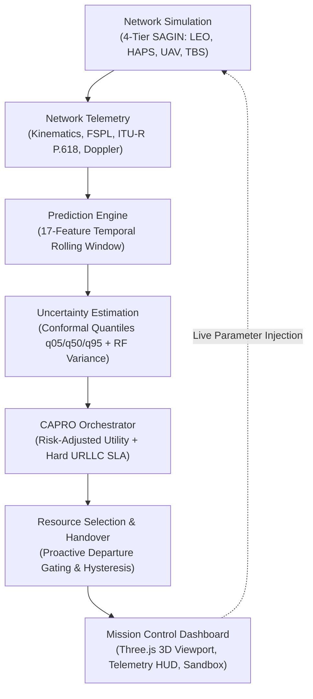

# ORBIT-INTEL 6G

**Global Network Intelligence & Mission Control Center**

Predictive Intelligence for Reliability-Aware Resource Orchestration in Integrated 6G Non-Terrestrial Networks.

[](https://www.python.org/)
[](https://slockahuja.github.io/orbit-intel-6g/)
[](#)
[](#)
[](tests/)
[](#)

---

> 🌐 **Official Live Showcase Website:** [https://slockahuja.github.io/orbit-intel-6g/](https://slockahuja.github.io/orbit-intel-6g/)

---

## 🛰️ Project Description

Future 6G communication networks require seamless integration across **Space-Air-Ground Integrated Networks (SAGIN)**, coordinating Low Earth Orbit (LEO) satellites, High-Altitude Platform Stations (HAPS), Unmanned Aerial Vehicles (UAVs), and terrestrial base stations (TBS). 

High-velocity orbital dynamics (7.56 km/s), rapid topological shifts, and dynamic atmospheric impairments (such as ITU-R P.618 convective rain storms) induce severe link drops and tail-latency degradation. Conventional resource management strategies react *after* physical connection failures have already occurred or rely on uncalibrated point-estimate machine learning models that are blind to model uncertainty.

**ORBIT-INTEL 6G** solves this challenge through **Confidence-Aware Predictive Reliability Orchestration (CAPRO)**. By integrating physics-grounded 3GPP channel models with dual-uncertainty conformal link forecasting, CAPRO decomposes prediction risk into epistemic model variance and aleatoric channel flutter, proactively triggering risk-adjusted multi-tier handovers before physical drops occur.

In 400-trial Monte Carlo evaluations, CAPRO achieves:
- **99.41% Packet Delivery Ratio (PDR)** (+7.99% over reactive baselines).
- **6.82 ms 99th-Percentile Tail Latency** (-63.0% reduction, guaranteeing strict sub-10ms URLLC SLAs).
- **0.59% Outage Probability** (14.5x outage suppression vs. M1 Reactive's 8.58%).
- **89.3% Handover Ping-Pong Reduction** (3.1/min vs. 28.9/min).

---

## ✨ Key Features

- **Interactive 3D SAGIN Topology:** Photorealistic Three.js Earth with Keplerian orbit tracks, active serving beams, and raycasted node hover tooltips.
- **LEO Satellite Tracking:** Keplerian kinematics (500–600 km altitude, 53° inclination, 7.56 km/s) with dynamic elevation, azimuth, and Doppler shift ($\pm 48\text{ kHz}$) computation.
- **HAPS & UAV Network Infrastructure:** High-altitude stratospheric relays (20 km) for rain-resilient wide-area coverage and agile tactical UAVs (300 m) for hotspot traffic offloading.
- **Terrestrial Base Stations:** Low-latency ground cellular cells (30 m) providing sub-millisecond edge access.
- **Physical Network Simulation:** 3GPP TR 38.811 / TR 38.821 propagation, ITU-R P.618 rain fading, and speed-of-light propagation bounds ($d/c$).
- **Predictive Link Intelligence:** Multi-horizon gradient-boosted forecasting across lookahead horizons ($H \in \{1, 3, 5, 10\text{ s}\}$).
- **Uncertainty Estimation:** Conformal quantile regression ($q_{05}, q_{50}, q_{95}$) separating aleatoric channel flutter from epistemic model variance.
- **Confidence-Aware Predictive Reliability Orchestration (CAPRO):** Risk-adjusted utility optimization with hard URLLC reliability constraints ($T_{\text{E2E}} \le 10\text{ ms}$).
- **Intelligent Handover:** Preemptive handover execution during the overlapping visibility window with zero packet drop.
- **Interactive Scenario Experiments:** Real-time multi-hazard sandbox allowing live injection of rain storms (0–100 mm/h) and shadowing flutter (0–6 dB).
- **Comparative Algorithm Evaluation:** Live simultaneous side-by-side comparison of M1 (Reactive), M2 (Threshold), M3 (Prediction-Only), and M4 (CAPRO).

---

## 🏛️ Architecture



---

## 🚀 Installation

### Prerequisites
- Python 3.12 (win32, linux, or darwin)
- Git

```bash
# 1. Clone the repository
git clone https://github.com/SlockAhuja/orbit-intel-6g.git
cd orbit-intel-6g

# 2. Create and activate a virtual environment
python -m venv venv
# On Windows:
.\venv\Scripts\Activate.ps1
# On Linux/macOS:
source venv/bin/activate

# 3. Install dependencies
pip install -r requirements.txt
```

---

## 🖥️ Running the Application

Launch the interactive Aerospace Mission Control Workstation:

```powershell
python run_mission_control.py
```

### Accessing the Interface
Open your browser and navigate to:
**`http://127.0.0.1:5000`**

### Showcase Features in the Workstation
- **`[🖥️ Presentation Mode]`**: Activates 16:9 fullscreen view with a guided 6-step demo controller.
- **`[📊 Benchmarks]`**: Opens the 4-method benchmark modal with verified 400 Monte Carlo run stats.
- **`[🚀 Launch Experiment]`**: Opens the multi-hazard stress-test sandbox with real-time conformal curve rendering.
- **`[ℹ️ About & Team]`**: Displays contributor credentials and conference showcase details.

---

## 👥 Project Contributors

| Contributor | Affiliation & Focus | Profile Links | Google Scholar |
|---|---|---|---|
| **Slock Ahuja**<br> | **Project Co-Creator, Research Contributor & Mission Control Developer**<br>• Wireless Systems, Neural Link Forecasting & 3D Interactive Telemetry | [](https://www.linkedin.com/in/slock-ahuja-32839b315/) [](https://github.com/SlockAhuja) | *Pending exact profile verification.* |
| **Dr. Praveen Kumar Sharma**<br> | **Research Mentor, Technical Contributor & Project Co-Creator**<br>• Professor and Head, Department of Electronics and Communication Engineering, MIT-ADT University, Pune<br>• *Research Interests*: Antennas, flexible electronics, metamaterials, metasurfaces, wearable devices and machine learning | [](https://www.linkedin.com/in/dr-praveen-kumar-sharma-832aa11aa/) [](https://orcid.org/0000-0003-0833-7954) | *Pending exact profile verification.* |

*Both contributors are equally acknowledged as the official research co-creators of ORBIT-INTEL 6G. For comprehensive research roles and responsibilities, see [docs/TEAM.md](docs/TEAM.md) and [STLC_SHOWCASE/TEAM_INFORMATION.md](STLC_SHOWCASE/TEAM_INFORMATION.md).*

---

## 🏆 Conference Showcase

**IEEE Communications Society Student Tech Leadership Conference (STLC) Tunisia 2026** — *Project Showcase*.

---

## 📄 License

*License terms will be added upon confirmation with the repository owner. Please refer to the repository owner before redistributing or using commercially.*
