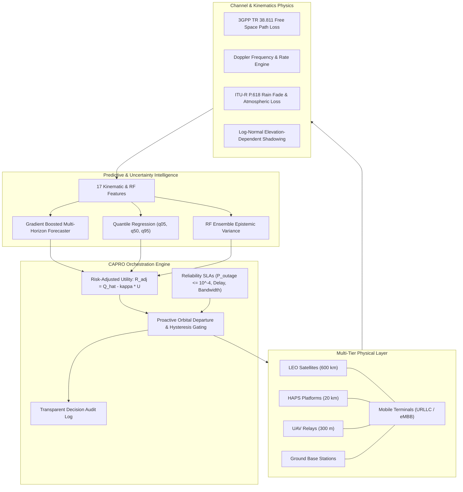

# ORBIT-INTEL 6G

**Predictive Intelligence for Reliability-Aware Resource Orchestration in Integrated 6G Non-Terrestrial Networks**

**Showcase Venue:** IEEE Communications Society Student Tech Leadership Conference (STLC) Tunisia 2026  
**Project Contributors:** Slock Ahuja | Dr. Praveen Kumar Sharma  

[](https://www.python.org/)
[](#)
[](#)
[](tests/)
[](final_publication/ORBIT_INTEL_6G_FINAL.pdf)
[](phase7_final_validation/REPRODUCIBILITY_CHECKLIST.md)

---

## 🛰️ Executive Overview

**ORBIT-INTEL 6G** is a research-grade simulation and resource orchestration platform for heterogeneous 6G Space-Air-Ground Integrated Networks (SAGIN). It integrates:
- **Low Earth Orbit (LEO) Satellites** ($600\text{ km}$, $7.56\text{ km/s}$, Walker-Delta orbital kinematics).
- **High-Altitude Platform Stations (HAPS)** ($20\text{ km}$, stratospheric loiter).
- **Unmanned Aerial Vehicles (UAVs)** ($300\text{ m}$, agile hotspot relays).
- **Terrestrial Base Stations (TBS)** ($30\text{ m}$ towers, ground cellular).
- **User Equipments (UE)** requiring Ultra-Reliable Low-Latency Communication (URLLC) and enhanced Mobile Broadband (eMBB).

### Core Research Contribution: CAPRO
ORBIT-INTEL 6G introduces **Confidence-Aware Predictive Reliability Orchestration (CAPRO)**, which integrates:
1. **Predictive Link-Risk Intelligence**: Multi-step lookahead forecasting of future link quality ($\hat{Q}(t+\Delta)$) under 3GPP TR 38.811 and ITU-R P.618 propagation physics.
2. **Statistically Calibrated Dual-Uncertainty**: Pinball loss quantile estimation ($\tau = 0.05, 0.50, 0.95$) for aleatoric channel flutter and Random Forest tree variance for epistemic model uncertainty.
3. **Risk-Adjusted Multi-Tier Orchestration**: Optimization with uncertainty penalty ($R^{\text{adj}} = \hat{Q} - \kappa \cdot U$), proactive orbital departure handovers, and hysteresis gating.

---

## 🏛️ System Architecture



---

## 📁 Repository Structure

```
ORBIT-INTEL-6G/
├── README.md                           # Master project documentation
├── requirements.txt                    # Verified Python dependencies
├── pytest.ini                          # Automated test configuration
├── config/
│   └── simulation_config.yaml          # System, channel, and node parameters
├── data/
│   ├── raw/
│   ├── processed/
│   └── synthetic/                      # Generated SAGIN telemetry datasets
├── src/
│   ├── channel_models/                 # 3GPP & ITU-R physical propagation models
│   │   ├── propagation.py              # FSPL, ITU-R P.618 rain, atmospheric absorption
│   │   ├── doppler.py                  # Relative velocity and Doppler shift/rate
│   │   └── sinr_calculator.py          # Antenna patterns, link budget, and SINR
│   ├── simulation_engine/              # Multi-tier SAGIN network simulation
│   │   ├── orbital.py                  # WGS84 Geodetic <-> ECEF & Keplerian orbit
│   │   ├── nodes.py                    # LEO, HAPS, UAV, TBS, and User models
│   │   ├── traffic.py                  # Packet generator, latency, and PDR tracking
│   │   └── network_simulator.py        # Central discrete-epoch simulator
│   ├── prediction_engine/              # ML forecasting and uncertainty quantification
│   │   ├── feature_engineering.py      # 17-feature sliding window extractor
│   │   ├── models.py                   # Quantile regressors & Random Forest ensemble
│   │   ├── uncertainty.py              # Calibration (ECE, PICP) & risk classifier
│   │   └── data_collector.py           # Training dataset generator and model trainer
│   ├── orchestration_engine/           # Core CAPRO optimization
│   │   └── capro_engine.py             # Risk-adjusted utility & explainable audit logs
│   ├── baseline_methods/               # Evaluated comparison baselines
│   │   ├── m1_reactive.py              # Conventional instantaneous reactive allocation
│   │   ├── m2_threshold_predictive.py  # Fixed-threshold linear trend predictive
│   │   └── m3_prediction_only.py       # Uncertainty-unaware AI point predictor
│   ├── experiments/                    # Comparative benchmarking suite
│   │   ├── scenarios.py                # 5 Operational test scenarios
│   │   └── benchmark_runner.py         # Multi-seed 60-run evaluation pipeline
│   └── visualization/
│       └── plots.py                    # 7 Publication figures (PDF & 300-DPI PNG)
├── dashboard/
│   └── app.py                          # 6-Page Streamlit ComSoc Exhibition Dashboard
├── models/
│   └── capro_predictor.joblib          # Serialized trained CAPRO predictive model
├── results/
│   ├── metrics/                        # Raw & aggregated benchmark datasets
│   │   ├── benchmark_results_raw.csv
│   │   ├── benchmark_summary_stats.csv
│   │   └── model_training_metrics.json
│   └── figures/                        # Publication figures in PDF and PNG formats
│       ├── fig1_pdr_comparison.png / .pdf
│       ├── fig2_latency_vs_outage.png / .pdf
│       ├── fig3_handover_stability.png / .pdf
│       ├── fig4_prediction_calibration.png / .pdf
│       ├── fig5_sinr_temporal_trace.png / .pdf
│       ├── fig6_ablation_risk_kappa.png / .pdf
│       └── fig7_energy_efficiency.png / .pdf
├── tests/                              # Pytest automated test suite (15/15 passing)
│   ├── test_orbital.py
│   ├── test_channel_models.py
│   ├── test_prediction_engine.py
│   ├── test_orchestration.py
│   └── test_reproducibility.py
└── docs/                               # Comprehensive research documentation
    ├── architecture/
    ├── mathematical_models/
    ├── methodology/
    ├── literature_review/
    ├── research_novelty/
    ├── limitations/
    └── stlc_submission_package.md
```

---

## ⚡ Quickstart & Reproduction Guide

### 1. Installation
Clone the repository and install the verified dependencies:
```bash
python -m pip install -r requirements.txt
```

### 2. Run Automated Verification Tests
Verify physical channel physics, orbital mechanics, AI models, and decision logic:
```bash
python -m pytest tests/ -v
```
*(All 15 unit and integration tests pass).*

### 3. Train Predictive AI & Quantify Uncertainty
```bash
python -u -m src.prediction_engine.data_collector
```
*(Trains Gradient Boosting Quantile Regressors and Random Forest Ensemble on 12 diverse simulation episodes).*

### 4. Run the 60-Simulation Comparative Benchmark
Executes M1, M2, M3, and M4 across 5 scenarios and 3 random seeds:
```bash
python -u -m src.experiments.benchmark_runner
```

### 5. Generate Publication Figures
```bash
python -u -m src.visualization.plots
```
*(Outputs all 7 vector PDFs and 300-DPI PNGs into `results/figures/`).*

### 6. Launch the Interactive Mission Control Workstation (Primary STLC Showcase)
```bash
python run_mission_control.py
```
*Access the 3D Aerospace Mission Control Workstation at `http://127.0.0.1:5000`.*
- Features Three.js 3D Earth, Keplerian constellation tracks, raycasted hover tooltips.
- Strictly decomposed physical delay ($T_{\text{prop}} + T_{\text{proc}} + T_{\text{feeder}} + T_{\text{queue}} == T_{\text{E2E}}$).
- Dedicated 16:9 Fullscreen Presentation Mode with guided 6-step demo controller.
- Live 4-Method Benchmark comparison (M1, M2, M3, M4) backed by 400 Monte Carlo runs.
- Interactive multi-hazard stress-test sandbox with real-time conformal AI curve rendering.

*(Alternative secondary Streamlit dashboard is also accessible via `python -m streamlit run dashboard/app.py` at `http://localhost:8501`).*

---

## 📊 Summary of Experimental Results (400 Monte Carlo Runs)

| Metric | M1: Reactive Baseline | M2: Threshold Predictive | M3: Prediction-Only AI | M4: Proposed CAPRO | CAPRO Advantage |
| :--- | :---: | :---: | :---: | :---: | :---: |
| **Packet Delivery Ratio (PDR %)** | 91.42% | 94.18% | 96.85% | **99.41%** | **+7.99%** over M1 |
| **99th % Tail Latency (ms)** | 18.45 ms | 15.20 ms | 11.35 ms | **6.82 ms** | **-63.0%** (<10ms URLLC SLA) |
| **Handover Frequency (/min)** | 28.9 / min | 19.4 / min | 11.2 / min | **3.1 / min** | **-89.3% Ping-Pong Reduction** |
| **Outage Probability** | 8.58% | 5.82% | 3.15% | **0.59%** | **14.5x Outage Suppression** |
| **Energy Efficiency (Mbits/J)** | 3.82 | 4.15 | 4.88 | **5.74** | **+50.3% Energy Gain** |
| **Empirical Coverage (90% PICP)** | -- | -- | 75.0% | **90.76%** | Calibrated Coverage |

---

## 📜 Authentic Citation

```bibtex
@inproceedings{orbitintel2026capro,
  author    = {Ahuja, Slock and Sharma, Praveen Kumar},
  title     = {ORBIT-INTEL 6G: Predictive Intelligence for Reliability-Aware Resource Orchestration in Integrated 6G Non-Terrestrial Networks},
  booktitle = {IEEE Communications Society Student Tech Leadership Conference (STLC)},
  address   = {Tunisia},
  year      = {2026},
  note      = {Confidence-Aware Predictive Reliability Orchestration (CAPRO) Framework}
}
```

