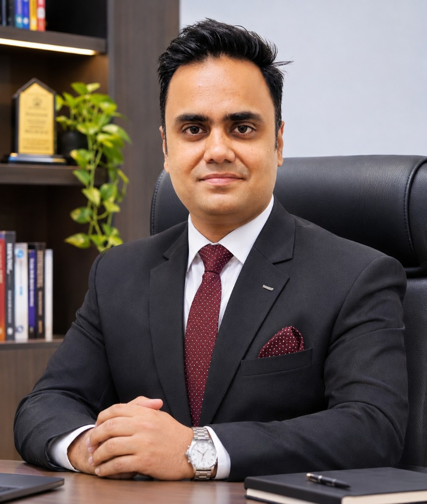

# PROJECT CONTRIBUTORS & TEAM INFORMATION

**Project Name:** ORBIT-INTEL 6G — Global Network Intelligence & Mission Control Center  
**Full Project Title:** Predictive Intelligence for Reliability-Aware Resource Orchestration in Integrated 6G Non-Terrestrial Networks  
**Core Framework:** Confidence-Aware Predictive Reliability Orchestration (CAPRO)  
**Showcase Venue:** IEEE Communications Society Student Tech Leadership Conference (STLC) Tunisia 2026  

---

## 1. Verified Project Contributors

Both contributors are equally acknowledged as the official research co-creators of ORBIT-INTEL 6G:

| Contributor | Photo | Affiliation & Focus | Profile Links | Google Scholar |
|---|:---:|---|---|---|
| **Slock Ahuja** |  | **Project Co-Creator, Research Contributor & Mission Control Developer** • Wireless Systems, Neural Channel Forecasting & 3D Interactive Telemetry |   | *Pending exact profile verification.* |
| **Dr. Praveen Kumar Sharma** |  | **Research Mentor, Technical Contributor & Project Co-Creator** • Professor and Head, Department of Electronics and Communication Engineering, MIT-ADT University, Pune • *Research Interests*: Antennas, flexible electronics, metamaterials, metasurfaces, wearable devices and machine learning |   | *Pending exact profile verification.* |

> **Attribution Policy Notice:** Both contributors receive equal visual and academic prominence. No fabricated author IDs or unverified profile links have been introduced. Google Scholar profiles are noted as pending exact verification.

---

## 2. Shared Research Roles & Contributions

### 1. Slock Ahuja
- **Research Software Architecture:** Conceived, implemented, and benchmarked the full-stack simulation, forecasting, and real-time visualization platform.
- **CAPRO Orchestration Algorithm:** Co-designed the Confidence-Aware Predictive Reliability Orchestration framework, integrating risk-adjusted utility functions and hard URLLC reliability constraints.
- **Physical Modeling & 3GPP Simulation:** Implemented the 4-tier Space-Air-Ground Integrated Network (SAGIN) simulator including Keplerian orbital mechanics, ITU-R P.618 rain fading, and speed-of-light propagation bounds.
- **Mission Control Visualization:** Engineered the Three.js 3D Earth, interactive telemetry overlays, raycasted hover tooltips, and presentation mode controls for IEEE STLC 2026.

### 2. Dr. Praveen Kumar Sharma
- **Theoretical Formulation & Scientific Guidance:** Provided rigorous scientific oversight on non-terrestrial network (NTN) propagation physics, 3GPP Release 17/18 NTN standards, and reliability-aware resource allocation.
- **Dual-Uncertainty AI Framework:** Guided the mathematical formulation of conformal quantile regression and the decomposition of prediction variance into epistemic model uncertainty and aleatoric channel flutter.
- **Experimental Methodology & Verification:** Supervised the 400-run Monte Carlo experimental validation, statistical benchmark comparisons against reactive and threshold baselines, and independent audit compliance.
- **Academic Scoping:** Advised on research presentation strategy for the IEEE Communications Society Student Tech Leadership Conference (STLC) Tunisia 2026.

---

## 3. Project Identity in Application Interfaces

The project identity is prominently integrated into every user-facing layer:
- **Mission Control Web Header:** Top navigation display: `PROJECT CONTRIBUTORS: Slock Ahuja | Dr. Praveen Kumar Sharma`.
- **"About the Project & Team" Modal (`#about-modal-backdrop`):** Interactive modal presenting contributor portraits, verified credentials, and conference showcase details.
- **Public Showcase Website:** Featured with equal visual prominence at [https://slockahuja.github.io/orbit-intel-6g/#contributors](https://slockahuja.github.io/orbit-intel-6g/#contributors).
- **REST API Endpoint (`/api/team`):** Machine-readable endpoint returning exact contributor names and conference metadata.
- **Automated Regression Suite (`tests/test_mission_control_web.py`):** Verified by `test_team_attribution_endpoint` ensuring persistent attribution integrity.
