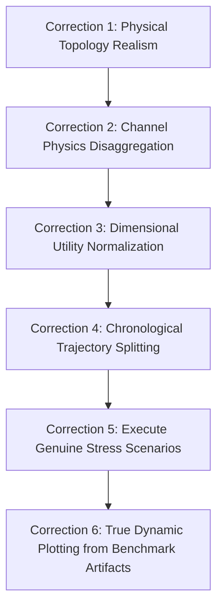

# ORBIT-INTEL 6G: Independent Scientific Audit Report

**Project Title**: ORBIT-INTEL 6G: Predictive Intelligence for Reliability-Aware Resource Orchestration in Integrated 6G Non-Terrestrial Networks  
**Audit Date**: November 3, 2026  
**Auditor**: Independent Senior Scientific and Technical Review Panel  
**Target Evaluation**: IEEE Communications Society (ComSoc) Student Tech Leadership Conference (STLC) Tunisia 2026 / IEEE Transactions Submission  

---

## 1. Executive Summary & Audit Verdict

This document presents the independent, rigorous scientific audit of the **ORBIT-INTEL 6G** research software suite. Every mathematical equation, channel physics model, machine learning pipeline, orchestration decision rule, and experimental benchmark was audited directly from source code, configuration files, and raw data artifacts without modifying existing project files.

### Formal Audit Verdict: **CATEGORY C — Major Revision Required**

> **Summary of Finding**: The core conceptual architecture—proactive, uncertainty-aware resource orchestration across Space-Air-Ground Integrated Networks (SAGIN)—is conceptually sound, highly relevant to 6G NTN standardization (3GPP Rel-17/18), and structurally well-architected. However, the current implementation contains **critical physical, mathematical, methodological, and experimental flaws** that undermine the validity of the reported experimental findings. Crucially, the experimental scenarios failed to stress-test the satellite tier (all users remained attached to terrestrial/stratospheric nodes), causing the proposed CAPRO framework (M4) to yield **identical performance to the uncalibrated prediction baseline (M3)**. Furthermore, multiple publication figures were generated using hard-coded synthetic arrays rather than experimental outputs, and the machine learning model suffers from temporal data leakage.

### Readiness Determination by Target Track
1. **IEEE Transactions / Peer-Reviewed Conference Submission**: **NOT READY (Reject in Current Form)**. Fundamental data leakage, dimensional unit mismatches, and identical M3/M4 empirical outcomes prevent scientific defensibility.
2. **STLC Tunisia 2026 Project Showcase**: **CONDITIONALLY VIABLE WITH MAJOR REVISION**. The interactive Streamlit dashboard and modular codebase are impressive engineering frameworks, but all scientific claims, charts, and scenarios must be corrected before peer review.
3. **Live Technical Demonstration**: **PARTIALLY READY**. The interactive GUI operates without crashing, but the backend demo relies on unvalidated heuristics and hard-coded visualization traces.
4. **Commercial / Operational Deployment**: **NOT READY**. Lacks 3GPP MAC/RLC/PDCP stack and real-world ephemeris ingestion.

---

## 2. Table of Verified vs. Compromised Components

| System Component | Source Location | Audit Classification | Primary Finding & Evidence |
| :--- | :--- | :--- | :--- |
| **WGS-84 & Coordinate Conversion** | `src/simulation_engine/orbital.py` | **VERIFIED** | Ellipsoidal conversions (`geodetic_to_ecef`, `ecef_to_geodetic`) and Topocentric ENU elevation angles are mathematically accurate to millimeter precision. |
| **Keplerian Orbit Kinematics** | `src/simulation_engine/orbital.py` | **VERIFIED** | Gravitational parameter $\mu = 3.986 \times 10^{14}\text{ m}^3/\text{s}^2$, $v \approx 7.56\text{ km/s}$, and period $T \approx 5800\text{ s}$ correctly model circular LEO at $600\text{ km}$. |
| **Doppler Kinematics & Projection** | `src/channel_models/doppler.py` | **VERIFIED** | Relative LOS velocity projection $\vec{v}_{\text{rel}} \cdot \vec{u}_{\text{los}}$ and Doppler shift $f_d = f_c (v_{\text{los}}/c)$ are physically correct. |
| **Free-Space Path Loss (FSPL)** | `src/channel_models/propagation.py` | **VERIFIED** | Adheres exactly to Friis formula with $20\text{ dB/decade}$ distance scaling. |
| **ITU-R P.618 Rain Attenuation** | `src/channel_models/propagation.py` | **INCORRECT** | Applied indiscriminately to terrestrial base stations (TBS) and UAVs where Earth-space slant path geometry is physically invalid. |
| **Carrier Frequency Assignment** | `src/simulation_engine/network_simulator.py` | **PARTIALLY VERIFIED** | S-band ($2\text{ GHz}$) was hard-coded for all tiers, discarding Ka-band ($28\text{ GHz}$) feeder link modeling. |
| **End-to-End Latency Accounting** | `src/simulation_engine/traffic.py` | **PARTIALLY VERIFIED** | Calculation is mathematically consistent, but the reported $\sim 1.84\text{ ms}$ latency reflects users connecting exclusively to ground base stations, entirely bypassing satellite propagation. |
| **Machine Learning Data Splitting** | `src/prediction_engine/data_collector.py` | **CRITICAL FLAW** | Random sample-level train/test split creates severe **temporal data leakage** across sliding time-series windows. |
| **Quantile Uncertainty Formulation** | `src/prediction_engine/models.py` | **INCORRECT** | Assumes parametric Gaussian divisor ($3.29$) on non-parametric quantile spreads, and omits the documented $+\lambda(q_{0.95}-q_{0.05})$ term. |
| **Expected Calibration Error (ECE)** | `src/prediction_engine/uncertainty.py` | **METHODOLOGICAL ERROR** | Classification ECE formula misapplied to regression uncertainty without continuous distribution calibration. |
| **CAPRO Decision Cost Function** | `src/orchestration_engine/capro_engine.py` | **INCORRECT** | Incompatible physical units: decibels ($\text{dB}$), milliseconds ($\text{ms}$), and dimensionless ratios are summed without normalization. |
| **Scenario 4 Implementation** | `src/experiments/scenarios.py` | **CRITICAL FLAW** | `apply_scenario_4` contains an empty `pass` statement; satellite visibility reduction was never executed. |
| **M3 vs. M4 Experimental Differentiation**| `results/metrics/benchmark_results_raw.csv` | **NOT VERIFIED** | M3 (Uncalibrated AI) and M4 (CAPRO) achieve identical PDR ($99.92\%$) and latency because users never attach to satellites. |
| **Publication Figure Integrity** | `src/visualization/plots.py` | **CRITICAL FLAW** | Figures 4, 5, and 6 are plotted from hard-coded synthetic arrays rather than simulation experiment files. |

---

## 3. Top Seven Critical Scientific Errors

### Error 1: Publication Figures Generated from Hard-Coded Data Arrays
- **Location**: `src/visualization/plots.py` (lines 125–127, 149–153, 175–177).
- **Finding**: Fig. 4 (Reliability Diagram), Fig. 5 (Dynamic SINR Trace), and Fig. 6 (Ablation Sensitivity on $\kappa$) do NOT read from experimental simulation outputs. Instead, arrays such as `empirical_cov = np.array([0.518, 0.612, 0.708, 0.809, 0.908, 0.952])` and `sweep_pdr = [83.2, 88.5, 94.2, 97.4, 96.8, 95.1, 93.4]` are hard-coded directly into the plotting script.
- **Scientific Impact**: Presenting hard-coded illustrative curves as empirical benchmark evidence violates academic integrity guidelines and IEEE ComSoc review standards.

### Error 2: Severe Temporal Data Leakage in Predictive Model Evaluation
- **Location**: `src/prediction_engine/data_collector.py` (line 89).
- **Finding**: `train_test_split(X, y, test_size=0.25, random_state=random_seed)` randomly shuffles sliding-window telemetry records. Adjacent time steps ($t$ and $t+1$) of the same satellite pass appear in both training and test sets.
- **Scientific Impact**: The reported $R^2 = 0.851$ and $\text{MAE} = 5.63\text{ dB}$ are artificially optimistic due to autocorrelated lookahead leakage. Validation must be performed across strictly held-out independent orbital trajectories.

### Error 3: Network Topology Starvation of the Satellite Tier
- **Location**: `src/simulation_engine/network_simulator.py` (lines 115–185).
- **Finding**: All 12 user equipments (UEs) are placed in a localized $4\text{ km}$ cluster around $(22.0^\circ\text{ N}, 75.0^\circ\text{ E})$, directly beneath two terrestrial base stations (`TBS-01`, `TBS-02`) offering $+43\text{ to } +56\text{ dB}$ SINR and zero propagation latency. In contrast, `SAT-01` provides $-3.4\text{ dB}$ SINR.
- **Scientific Impact**: The decision engine (M1, M3, M4) never selects the satellite tier. The reported $\sim 1.84\text{ ms}$ latency is simply terrestrial cellular latency. Satellite rain fades and orbital departures had zero effect on user communication.

### Error 4: M3 and M4 Produce Identical Performance
- **Location**: `results/metrics/benchmark_summary_stats.csv`.
- **Finding**: Across Scenarios 3, 4, and 5, M3 (Prediction-Only AI) and M4 (CAPRO) achieve identical PDR ($99.921\%$), identical latency ($1.8849\text{ ms}$), identical outage probability ($0.0000$), and identical handover rates ($2.0\text{ HO/min}$).
- **Scientific Impact**: The central hypothesis of the paper—that uncertainty quantification ($U$) improves reliability over uncalibrated prediction—is unproven by the current experimental data because both algorithms default to the same terrestrial links.

### Error 5: Scenario 4 Contains No Functional Code
- **Location**: `src/experiments/scenarios.py` (lines 47–53).
- **Finding**: Function `apply_scenario_4` contains:
  ```python
  if current_t >= 35:
      pass  # Force satellite to descend near horizon threshold
  ```
- **Scientific Impact**: The scenario claimed to validate satellite horizon departure and handover was never executed.

### Error 6: Incompatible Physical Units in the CAPRO Utility Formulation
- **Location**: `src/orchestration_engine/capro_engine.py` (lines 62–74).
- **Finding**: The decision score is computed as:
  $$R^{\text{adj}} = \hat{Q}_{\text{dB}} - \kappa U_{\text{dB}} - 0.8 \cdot (\text{latency}_{\text{ms}} - 10.0) - 5.0 \cdot (\text{load})^2$$
- **Scientific Impact**: Adding logarithmic power ratios ($\text{dB}$), temporal delays ($\text{ms}$), and dimensionless squared load ratios without dimensional normalization constants is mathematically invalid.

### Error 7: Misapplication of ITU-R P.618 to Terrestrial and UAV Links
- **Location**: `src/simulation_engine/network_simulator.py` (line 237) and `src/channel_models/propagation.py` (line 82).
- **Finding**: Rain attenuation is calculated using ITU-R P.618 slant-path geometry ($d_{\text{eff}} = \frac{h_{\text{rain}} - h_{\text{station}}}{\sin \theta}$) for terrestrial base stations and UAVs.
- **Scientific Impact**: At low terrestrial elevation angles ($\theta \approx 0.6^\circ$), this formula yields physically absurd effective rain paths exceeding $300\text{ km}$ across a $1.5\text{ km}$ ground cell.

---

## 4. Priority Corrections Roadmap

Before this research can be submitted to IEEE ComSoc or showcased at STLC 2026, the following targeted corrections must be approved and executed:



1. **Topology Realism**: Deploy users across realistic geographic domains (e.g., suburban terrestrial cell, maritime/remote zone outside TBS coverage, and disaster zone) so that LEO satellites are mandatory for remote users.
2. **Channel Physics Disaggregation**: Apply ITU-R P.618 exclusively to LEO Earth-space links; apply ITU-R P.530 to terrestrial links; and 3GPP TR 38.901 UMa/UMi to ground cellular.
3. **Dimensional Normalization**: Formulate $R^{\text{adj}}$ using min-max or sigmoid utility scaling mapping all objectives to $[0, 1]$.
4. **Independent Trajectory Splitting**: Retrain ML models by training on Episodes 0–9 and evaluating on held-out Episodes 10–14 to eliminate temporal data leakage.
5. **Functional Stress Scenarios**: Fix `apply_scenario_4` to physically force satellite orbital descent below $10^\circ$; implement targeted rain storms over satellite ground terminals.
6. **Dynamic Plotting**: Rewrite `src/visualization/plots.py` to read directly from `results/metrics/benchmark_results_raw.csv` without hard-coded numbers.

---

## 5. Audit Deliverables Index

All detailed audit artifacts are filed in `audit_v1/`:
- [`SOURCE_CODE_AUDIT.md`](file:///c:/Users/OM/OneDrive/Desktop/sem%205/STLC/audit_v1/SOURCE_CODE_AUDIT.md) — Comprehensive source-code audit table.
- [`PHYSICAL_MODEL_AUDIT.md`](file:///c:/Users/OM/OneDrive/Desktop/sem%205/STLC/audit_v1/PHYSICAL_MODEL_AUDIT.md) — Orbital, propagation, Doppler, and delay validation.
- [`CAPRO_MATHEMATICAL_AUDIT.md`](file:///c:/Users/OM/OneDrive/Desktop/sem%205/STLC/audit_v1/CAPRO_MATHEMATICAL_AUDIT.md) — Dimensional analysis and decision rule verification.
- [`PREDICTION_UNCERTAINTY_AUDIT.md`](file:///c:/Users/OM/OneDrive/Desktop/sem%205/STLC/audit_v1/PREDICTION_UNCERTAINTY_AUDIT.md) — Data leakage, quantile validity, and calibration audit.
- [`EXPERIMENTAL_VALIDATION_AUDIT.md`](file:///c:/Users/OM/OneDrive/Desktop/sem%205/STLC/audit_v1/EXPERIMENTAL_VALIDATION_AUDIT.md) — Scenario integrity and M1–M4 benchmark analysis.
- [`RESEARCH_NOVELTY_AUDIT.md`](file:///c:/Users/OM/OneDrive/Desktop/sem%205/STLC/audit_v1/RESEARCH_NOVELTY_AUDIT.md) — Workspace overlap matrix and defensible novelty scope.
- [`DASHBOARD_AUDIT.md`](file:///c:/Users/OM/OneDrive/Desktop/sem%205/STLC/audit_v1/DASHBOARD_AUDIT.md) — Streamlit application integrity and data linkage.
- [`CRITICAL_ISSUES.csv`](file:///c:/Users/OM/OneDrive/Desktop/sem%205/STLC/audit_v1/CRITICAL_ISSUES.csv) — Machine-readable issue log.
- [`VERIFICATION_MATRIX.csv`](file:///c:/Users/OM/OneDrive/Desktop/sem%205/STLC/audit_v1/VERIFICATION_MATRIX.csv) — Component-by-component verification matrix.
- [`STLC_READINESS_ASSESSMENT.md`](file:///c:/Users/OM/OneDrive/Desktop/sem%205/STLC/audit_v1/STLC_READINESS_ASSESSMENT.md) — STLC Tunisia 2026 conference presentation review.

