# ORBIT-INTEL 6G — SYSTEM ARCHITECTURE SPECIFICATION

**Project Title:** ORBIT-INTEL 6G: Predictive Intelligence for Reliability-Aware Resource Orchestration in Integrated 6G Non-Terrestrial Networks  
**Contributors:** Slock Ahuja | Dr. Praveen Kumar Sharma  
**Target Showcase:** IEEE Communications Society Student Tech Leadership Conference (STLC) Tunisia 2026  

---

## 1. High-Level System Flow

```mermaid
flowchart TD
    subgraph Physical_Simulation ["1. Multi-Tier SAGIN Simulation"]
        LEO["LEO Satellites (600 km, 7.56 km/s)"]
        HAPS["Stratospheric HAPS (20 km)"]
        UAV["Tactical UAVs (300 m)"]
        TBS["Terrestrial gNodeB Cells (30 m)"]
        UE["Mobile Terminals (URLLC & eMBB)"]
    end

    subgraph Physics_Engine ["2. Propagation & Channel Physics"]
        FSPL["3GPP Free Space Path Loss (TR 38.811/821)"]
        Rain["ITU-R P.618 Rain Attenuation Engine"]
        Doppler["Topocentric Relative Velocity & Doppler (+-48 kHz)"]
        Latency["Strict Latency Decomposition: T_prop + T_proc + T_feeder + T_queue"]
    end

    subgraph AI_Engine ["3. Conformal Prediction & Uncertainty Quantification"]
        Features["17-Feature Temporal Rolling Window"]
        GBM["Gradient-Boosted Conformal Regressors (q05, q50, q95)"]
        Variance["RF Ensemble Epistemic Tree Variance"]
        Hazard["Outage Hazard Classifier (q05 < 3.0 dB)"]
    end

    subgraph Orchestration ["4. CAPRO Orchestration Engine"]
        Utility["Risk-Adjusted Utility Optimization: J = Q_hat - kappa * U"]
        Constraints["Hard SLA Constraints (Latency < 10ms, Outage Margin)"]
        Handover["Proactive Departure Gating & Hysteresis Suppression"]
        Explain["Explainable Decision Audit Generation"]
    end

    subgraph Mission_Control ["5. Interactive Mission Control Dashboard"]
        ThreeJS["3D Constellation Viewport (Three.js Earth)"]
        Telemetry["Real-Time Telemetry & Decomposed Latency Panels"]
        Sandbox["Multi-Hazard Stress-Test Sandbox"]
        Presentation["16:9 Presentation Mode with Guided Demo Controller"]
    end

    Physical_Simulation --> Physics_Engine
    Physics_Engine --> AI_Engine
    AI_Engine --> Orchestration
    Orchestration --> Mission_Control
    Mission_Control -. User Interaction / Injection .-> Physical_Simulation
```

---

## 2. Multi-Tier Physical Network Architecture

ORBIT-INTEL 6G simulates a disaggregated four-tier Space-Air-Ground Integrated Network (SAGIN) serving heterogeneous mobile terminals:

| Tier | Representative Node | Altitude / Height | Velocity | Carrier Frequency | Primary Role |
|---|---|---|---|---|---|
| **Space (LEO)** | `SAT-01`, `SAT-02` | $600.0\text{ km}$ | $7.56\text{ km/s}$ (Keplerian) | $8.402\text{ GHz}$ (S/X-band) | Global coverage, high-speed backbone |
| **Stratosphere (HAPS)** | `HAPS-01` | $20.0\text{ km}$ | Quasi-stationary | $2.1\text{ GHz}$ | Wide-area regional relay, rain-resilient bypass |
| **Aerial (UAV)** | `UAV-01` | $300\text{ m}$ | $15.0\text{ m/s}$ | $3.5\text{ GHz}$ (Mid-band) | Localized hotspot traffic offloading |
| **Terrestrial (TBS)** | `TBS-01`, `TBS-02`, `TBS-03` | $30\text{ m}$ | Fixed | $3.5\text{ GHz}$ | Ultra-low-latency edge access (<1 ms) |
| **User Cohort** | `UE-01` to `UE-12` | Ground Level | $1.5\text{ to }30\text{ m/s}$ | Multi-band | URLLC (sub-10ms) & eMBB (high throughput) |

---

## 3. Disaggregated Propagation & Latency Engine

### 3.1 Strict Latency Decomposition Model
All network links strictly decompose end-to-end latency:

$$T_{\text{E2E}} = T_{\text{prop}} + T_{\text{proc}} + T_{\text{feeder}} + T_{\text{queue}}$$

- **Speed-of-Light Propagation Delay ($T_{\text{prop}}$):**
  $$T_{\text{prop}} = \frac{d}{c} \times 10^3 \quad [\text{ms}]$$
  where $c = 299,792,458\text{ m/s}$, and $d$ is the 3D slant range computed in WGS-84 ECEF coordinates.
- **Access Processing Delay ($T_{\text{proc}}$):**
  - LEO Satellites: $2.50\text{ ms}$
  - HAPS Relays: $1.20\text{ ms}$
  - Tactical UAVs: $0.80\text{ ms}$
  - Terrestrial gNodeBs: $0.30\text{ ms}$
- **Feeder / Backhaul Transport Delay ($T_{\text{feeder}}$):**
  - LEO Satellites: $3.20\text{ ms}$ (satellite-to-gateway transport)
  - HAPS Relays: $0.50\text{ ms}$
  - Tactical UAVs: $0.30\text{ ms}$
  - Terrestrial gNodeBs: $0.10\text{ ms}$
- **Queueing Delay ($T_{\text{queue}}$):** Dynamically tracked per node based on instantaneous queue buffer state ($0.10\text{ to }0.50\text{ ms}$).

### 3.2 Atmospheric & Channel Attenuation
- **Free Space Path Loss (3GPP TR 38.811 / TR 38.821):**
  $$\text{FSPL}(d, f) = 20\log_{10}(d) + 20\log_{10}(f) + 20\log_{10}\left(\frac{4\pi}{c}\right)$$
- **ITU-R P.618 Rain Attenuation:** Evaluated exclusively on slant non-terrestrial links as a function of point rain intensity $R_{0.01}$ (mm/h) and topocentric elevation angle $\theta_{\text{elev}}$.
- **Elevation-Dependent Shadowing:** Log-normal shadow fading with angle-dependent standard deviation:
  $$\sigma_{\text{SF}}(\theta_{\text{elev}}) = \sigma_0 \cdot \exp(-\theta_{\text{elev}} / \theta_0)$$

---

## 4. Dual-Uncertainty AI Forecasting Engine

The prediction pipeline extracts 17 rolling kinematic and radio-frequency features:
- Geometric: Slant distance, topocentric elevation, elevation rate of change ($\dot{\theta}$).
- Kinematic: Doppler frequency shift ($f_D$), Doppler rate ($\dot{f}_D$), remaining visibility duration ($T_{\text{vis}}$).
- RF Quality: Instantaneous SINR, rolling mean SINR (3s, 5s), SINR trend slope, path loss.

### 4.1 Conformal Quantile Formulation
Three gradient-boosted regression models predict future link quality at lookahead horizons $H \in \{1, 3, 5, 10\text{ s}\}$:
- $\hat{q}_{05}$: 5th-percentile conservative lower bound.
- $\hat{q}_{50}$: 50th-percentile median expected SINR.
- $\hat{q}_{95}$: 95th-percentile optimistic upper bound.

### 4.2 Disaggregated Uncertainty Quantification
- **Aleatoric Uncertainty ($U_{\text{aleatoric}}$):** High-frequency channel flutter reflected in the conformal interval width:
  $$U_{\text{aleatoric}} = \hat{q}_{95} - \hat{q}_{05}$$
- **Epistemic Uncertainty ($U_{\text{epistemic}}$):** Model variance captured through Random Forest ensemble tree variance:
  $$U_{\text{epistemic}} = \sqrt{\frac{1}{B} \sum_{b=1}^B (\hat{y}_b - \bar{y})^2}$$

---

## 5. CAPRO Orchestration Framework

**Confidence-Aware Predictive Reliability Orchestration (CAPRO)** solves the multi-tier attachment problem by maximizing a risk-adjusted utility function subject to hard URLLC reliability constraints:

$$\max_{j \in \mathcal{C}_{\text{feasible}}} J_j(t) = w_{\text{sinr}} \cdot \tilde{\gamma}_j(t+\Delta) - \kappa \cdot U_j(t+\Delta) - w_{\text{lat}} \cdot \tilde{T}_j(t+\Delta) - \beta \cdot \mathbf{1}_{\{j \ne j_{\text{curr}}\}}$$

### Hard Feasibility Constraints:
1. **Conservative Outage Guarantee:** $\hat{q}_{05, j}(t+\Delta) \ge \gamma_{\text{th}} = 3.0\text{ dB}$.
2. **URLLC Latency Bound:** $T_{\text{E2E}, j}(t+\Delta) \le 10.0\text{ ms}$ (for URLLC service flows).
3. **Orbital Departure Buffer:** $T_{\text{vis}, j}(t) > T_{\text{HO\_margin}} = 12.0\text{ s}$.

If candidate $j$ violates any hard constraint, it is strictly eliminated from selection, preventing link drops and avoiding ping-pong handovers.

