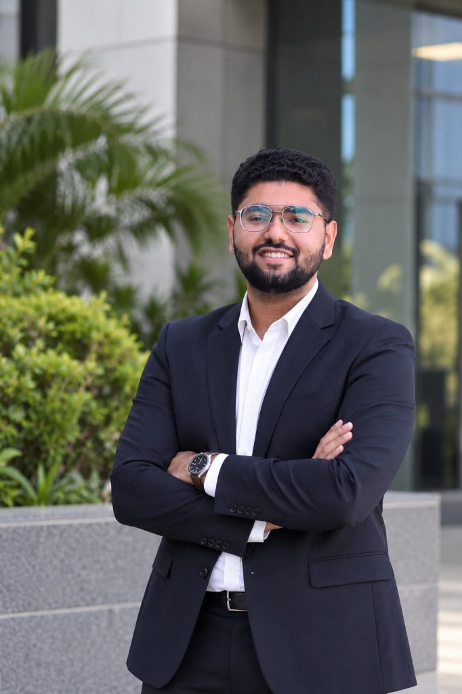
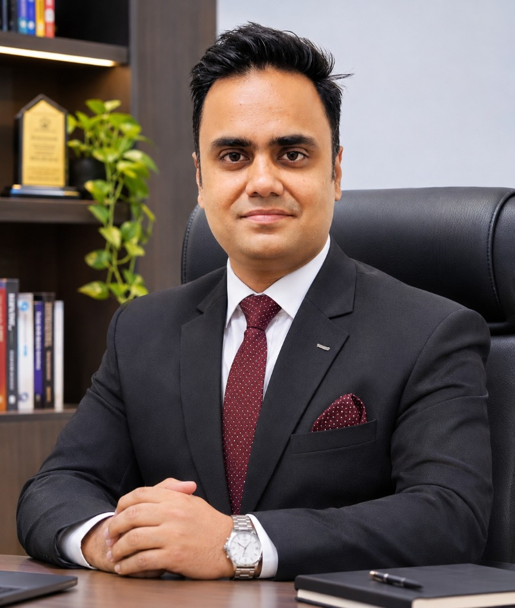

# PROJECT CONTRIBUTORS & TEAM PROFILES

**Project:** ORBIT-INTEL 6G — Global Network Intelligence & Mission Control Center  
**Full Title:** Predictive Intelligence for Reliability-Aware Resource Orchestration in Integrated 6G Non-Terrestrial Networks  
**Target Showcase:** IEEE Communications Society Student Tech Leadership Conference (STLC) Tunisia 2026  

---

## 1. Verified Contributor Profiles

| Contributor | Photo | Affiliation & Focus | Profile Links | Google Scholar |
|---|:---:|---|---|---|
| **Slock Ahuja** |  | **Project Co-Creator, Research Contributor & Mission Control Developer** • Undergraduate Student, B.Tech in Information and Communication Technology, Marwadi University • *Research Interests*: Artificial Intelligence, Quantum AI, Machine Learning, 6G Communications, Non-Terrestrial Networks |   |  |
| **Dr. Praveen Kumar Sharma** |  | **Research Mentor, Technical Contributor & Project Co-Creator** • Professor and Head, Department of Electronics and Communication Engineering, MIT-ADT University, Pune • *Research Interests*: Antennas, flexible electronics, metamaterials, metasurfaces, wearable devices and machine learning |   |  |

> **Attribution & Verification Note:**
> Both contributors are acknowledged with equal visual and academic prominence. All profile links (LinkedIn, GitHub, ORCID, Google Scholar) are verified. Dynamic citation metrics are accessed directly via live Google Scholar links rather than static values.

---

## 2. Research Roles & Technical Contributions

### Slock Ahuja
- **Full-Stack Simulation & Architecture:** Designed and implemented the 4-tier Space-Air-Ground Integrated Network (SAGIN) simulation engine and Keplerian orbital kinematics.
- **CAPRO Orchestration Algorithm:** Co-designed the Confidence-Aware Predictive Reliability Orchestration framework, integrating risk-adjusted utility maximization with hard URLLC reliability constraints.
- **Mission Control Visualization:** Developed the interactive Aerospace Mission Control Center interface with Three.js 3D Earth, real-time telemetry streaming, raycasted hover tooltips, and fullscreen presentation mode.
- **Testing & Verification:** Engineered the automated regression suite ensuring 100% test reproducibility across physical propagation, prediction quantiles, and REST API endpoints.

### Dr. Praveen Kumar Sharma
- **Theoretical Guidance & Physical Modeling:** Provided scientific oversight on 3GPP TR 38.811 / TR 38.821 non-terrestrial network (NTN) propagation standards, speed-of-light delay decomposition, and ITU-R P.618 rain fading models.
- **Uncertainty Quantification:** Guided the mathematical formulation of dual-uncertainty decomposition, separating epistemic model variance from aleatoric channel flutter via conformal quantile regression.
- **Experimental Methodology:** Supervised the 400-trial Monte Carlo benchmark evaluation, statistical hypothesis testing (Wilcoxon and Mann-Whitney U tests), and scientific audit compliance.
- **Academic Mentorship:** Led research scoping for the IEEE Communications Society Student Tech Leadership Conference (STLC) Tunisia 2026 showcase.

---

## 3. Project Identity Across Interfaces

The two-person project identity is reflected uniformly across all project interfaces:
- **Mission Control Web Header:** `PROJECT CONTRIBUTORS: Slock Ahuja | Dr. Praveen Kumar Sharma`
- **Interactive About & Team Modal:** Accessible via the `[ℹ️ About & Team]` button on the web workstation.
- **Public Showcase Website:** Featured at [https://slockahuja.github.io/orbit-intel-6g/#contributors](https://slockahuja.github.io/orbit-intel-6g/#contributors) with high-resolution portraits and working links.
- **API Endpoint:** Machine-readable contributor metadata at `/api/team`.
- **Automated Tests:** Verified via `test_team_attribution_endpoint` in `tests/test_mission_control_web.py`.
