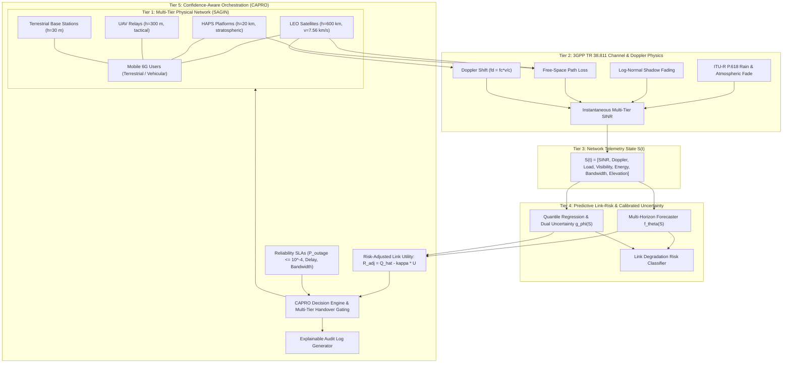

# ORBIT-INTEL 6G: System Architecture

---

## Architecture Components

1. **`simulation_engine`**:
   - Manages physical node geometry, orbital kinematics (Keplerian / SGP4 / Skyfield mechanics), user mobility trajectories, and dynamic traffic demands.
2. **`channel_models`**:
   - Implements 3GPP TR 38.811 and ITU-R P.618 propagation physics, Doppler shifts, fast/slow fading, and multi-tier SINR calculations.
3. **`prediction_engine`**:
   - Trains and executes high-efficiency Gradient Boosted and Random Forest estimators with quantile heads ($\tau = 0.05, 0.50, 0.95$) for calibrated prediction intervals.
4. **`orchestration_engine`**:
   - Houses the core CAPRO logic, risk-adjusted utility evaluation, proactive handover gating, and explainable decision records.
5. **`baseline_methods`**:
   - Implements M1 (Reactive), M2 (Threshold-based), and M3 (Prediction-only AI) for rigorous scientific benchmarking under identical scenario seeds.
6. **`experiments`**:
   - Runs Monte Carlo simulations over 5 standard scenarios, calculating 10 key performance indicators (KPIs) with confidence intervals.
7. **`visualization`**:
   - Produces publication-grade 300-DPI charts (Matplotlib / Seaborn) and interactive Plotly figures.
8. **`dashboard`**:
   - Multi-page interactive Streamlit research exhibition platform.

