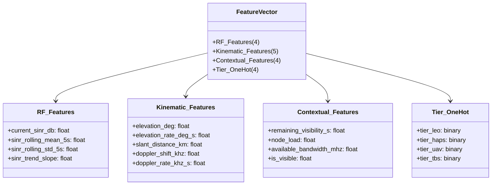

# PHASE 2 SPECIFICATION: FEATURE SPACE, TARGET HORIZONS & NORMALIZATION PROTOCOL

**Project Title:** ORBIT-INTEL 6G: Predictive Intelligence for Reliability-Aware Resource Orchestration in Integrated 6G Non-Terrestrial Networks  
**Target Venue:** IEEE Communications Society Student Tech Leadership Conference (STLC) Tunisia 2026  
**Document:** Feature Engineering Specification & Target Definition  
**Date:** November 2026  

---

## 1. Executive Overview

In Phase 2 of ORBIT-INTEL 6G, the feature extraction and target prediction pipelines have been re-engineered to support multi-horizon link quality forecasting across heterogeneous Space-Air-Ground Integrated Networks (SAGIN).

Unlike the original baseline which extracted ad-hoc features for a single 10-second lookahead, Phase 2 implements:
1. **Multi-Horizon Targets**: Explicit evaluation across 4 candidate operational horizons: $H \in \{1\text{ s}, 3\text{ s}, 5\text{ s}, 10\text{ s}\}$.
2. **Disaggregated Kinematic, RF, and Contextual Features**: 17 standardized input dimensions capturing orbital mechanics, link geometry, Doppler dynamics, short-term channel fading, and node congestion.
3. **Strict Out-of-Sample Normalization**: Feature scaling via `StandardScaler` fitted **exclusively on the training partition** ($\mathcal{D}_{\text{train}}$), eliminating distributional information leakage into validation and locked test partitions.

---

## 2. Multi-Horizon Prediction Targets

Predicting link quality across heterogeneous NTN tiers requires distinct forecasting horizons corresponding to different network orchestration timescales:

| Horizon $H$ | Operational Timescale | Network Orchestration Function | Target Variable Name |
| :---: | :---: | :--- | :--- |
| **$H = 1\text{ s}$** | Immediate / Microscopic | Rapid beam tracking, fast link adaptation, MCS selection | `target_sinr_1s` |
| **$H = 3\text{ s}$** | Short-Term / Reactive | Fast retransmission scheduling, local UAV/TBS inter-cell handover | `target_sinr_3s` |
| **$H = 5\text{ s}$** | Medium-Term / Proactive | Proactive HAPS/LEO beam reassociation, buffer reservation | `target_sinr_5s` |
| **$H = 10\text{ s}$** | Long-Term / Strategic | Orbital departure handover, multi-tier traffic steering, CAPRO orchestration | `target_sinr_10s` |

### 2.1 Continuous vs. Discrete Classification Targets

For each horizon $H$, both continuous link quality and binary risk classifications are defined:
1. **Continuous Target**: $y_t^{(H)} = \text{SINR}(t + H) \in [-\infty, +\infty]\text{ dB}$.
2. **Binary Outage Target**:
   $$\mathbb{I}_{\text{outage}}^{(H)}(t) = \begin{cases} 1, & \text{if } \text{SINR}(t + H) < 3.0\text{ dB} \\ 0, & \text{otherwise} \end{cases}$$
3. **Strategic Degradation Target ($H=10\text{ s}$)**:
   $$\mathbb{I}_{\text{degradation}}^{(10\text{s})}(t) = \begin{cases} 1, & \text{if } \text{SINR}(t + 10) - \text{SINR}(t) \le -3.0\text{ dB} \\ 0, & \text{otherwise} \end{cases}$$

---

## 3. Feature Space Taxonomy

The feature vector $\mathbf{x}_t \in \mathbb{R}^{17}$ is extracted at time $t$ from a 5-second sliding observation window of telemetry $\mathcal{W}_t = \{\mathbf{s}_{\tau} \mid \tau \in [t-5, t]\}$ for each user-node pair $(u, n)$.

### 3.1 Detailed Feature Definitions

| Index | Feature Name | Dimension / Unit | Description & Physical Justification |
| :---: | :--- | :---: | :--- |
| 1 | `current_sinr_db` | dB | Current instantaneous Signal-to-Interference-plus-Noise Ratio at time $t$. Baseline signal quality. |
| 2 | `sinr_rolling_mean_5s` | dB | Empirical mean of SINR over past 5 seconds: $\bar{\gamma}_5 = \frac{1}{K}\sum_{\tau=t-4}^t \gamma(\tau)$. Filters fast fading. |
| 3 | `sinr_rolling_std_5s` | dB | Sample standard deviation over past 5 seconds: $s_{\gamma} = \sqrt{\frac{1}{K-1}\sum (\gamma - \bar{\gamma})^2}$. Quantifies volatility. |
| 4 | `sinr_trend_slope` | dB/s | First-order least-squares polynomial slope over 5-second window: $\beta_1 = \frac{\sum (t_i - \bar{t})(\gamma_i - \bar{\gamma})}{\sum (t_i - \bar{t})^2}$. |
| 5 | `elevation_deg` | Degrees ($^\circ$) | Topocentric elevation angle $\theta_{\text{elev}}$ relative to the local horizontal tangent plane. |
| 6 | `elevation_rate_deg_s` | Degrees/s | Finite difference rate of elevation change: $\dot{\theta} = \theta_t - \theta_{t-1}$. Crucial for predicting satellite departure. |
| 7 | `slant_distance_km` | km | 3D Euclidean distance $d = \|\mathbf{r}_{\text{node}} - \mathbf{r}_{\text{user}}\|$. Governs free-space path loss and slant delay. |
| 8 | `doppler_shift_khz` | kHz | Projected relative line-of-sight Doppler carrier frequency shift $f_D = -\frac{f_c}{c}(\mathbf{v}_{\text{rel}} \cdot \mathbf{u}_{\text{los}})$. |
| 9 | `doppler_rate_khz_s` | kHz/s | Doppler frequency derivative $\dot{f}_D = f_D(t) - f_D(t-1)$. Directly tracks satellite angular acceleration. |
| 10 | `remaining_visibility_s` | Seconds | Numerical lookahead time until node breaches minimum elevation threshold ($\theta < \theta_{\text{min}}$). |
| 11 | `node_load` | $[0.0, 1.0]$ | Ratio of currently allocated bandwidth / capacity to total available capacity. Predicts queuing congestion. |
| 12 | `available_bandwidth_mhz`| MHz | Spectrum bandwidth allocated to the tier ($100\text{ MHz}$ LEO, $40\text{ MHz}$ HAPS, $20\text{ MHz}$ UAV, $50\text{ MHz}$ TBS). |
| 13 | `tier_leo` | $\{0, 1\}$ | One-hot binary indicator: link belongs to Low Earth Orbit satellite tier. |
| 14 | `tier_haps` | $\{0, 1\}$ | One-hot binary indicator: link belongs to High Altitude Platform Station tier. |
| 15 | `tier_uav` | $\{0, 1\}$ | One-hot binary indicator: link belongs to Unmanned Aerial Vehicle tier. |
| 16 | `tier_tbs` | $\{0, 1\}$ | One-hot binary indicator: link belongs to Terrestrial Base Station tier. |
| 17 | `is_visible` | $\{0, 1\}$ | Operational visibility indicator ($\theta \ge \theta_{\text{min}}$ and within cell coverage radius). |

---

## 4. Normalization and Scaling Protocol

### 4.1 Strict Out-of-Sample Normalization

Standard machine learning models (especially gradient-based and distance-based estimators) require feature normalization. To prevent data contamination:
1. `StandardScaler` computes sample mean $\hat{\boldsymbol{\mu}}_{\text{train}}$ and variance $\hat{\boldsymbol{\sigma}}_{\text{train}}^2$ **strictly from $\mathcal{D}_{\text{train}}$**:
   $$\hat{\mu}_j = \frac{1}{N_{\text{train}}} \sum_{i=1}^{N_{\text{train}}} x_{i,j}^{(\text{train})}, \quad \hat{\sigma}_j = \sqrt{\frac{1}{N_{\text{train}}-1} \sum_{i=1}^{N_{\text{train}}} \left( x_{i,j}^{(\text{train})} - \hat{\mu}_j \right)^2}$$
2. The transformation is applied to validation and test sets using the training parameters:
   $$\tilde{x}_{i,j}^{(\text{val})} = \frac{x_{i,j}^{(\text{val})} - \hat{\mu}_j}{\hat{\sigma}_j}, \quad \tilde{x}_{i,j}^{(\text{test})} = \frac{x_{i,j}^{(\text{test})} - \hat{\mu}_j}{\hat{\sigma}_j}$$
3. Tree-based ensembles (Random Forest and Gradient Boosting) are invariant to monotonic transformations, allowing them to train on either raw or standardized features without metric degradation, but standardized features guarantee numerical stability across linear baselines and quantile regression loss functions.

