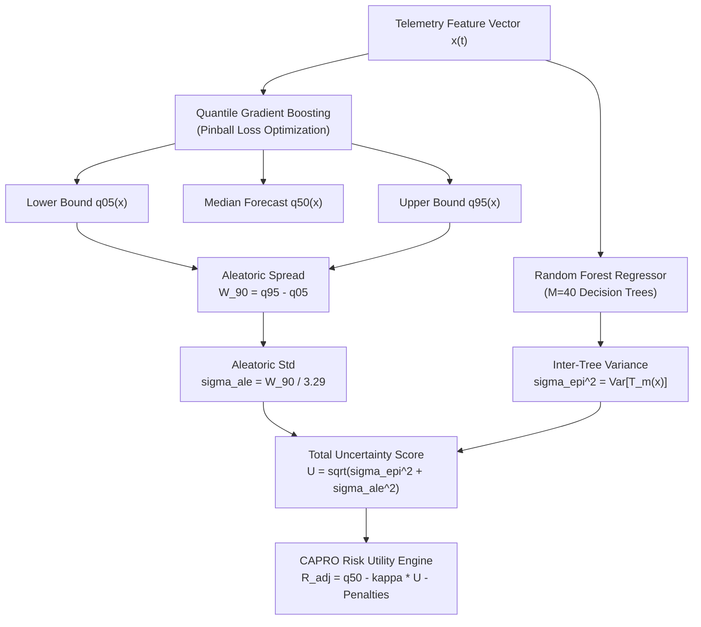

# PHASE 2 RESEARCH REPORT: DUAL UNCERTAINTY QUANTIFICATION & DISAGGREGATION

**Project Title:** ORBIT-INTEL 6G: Predictive Intelligence for Reliability-Aware Resource Orchestration in Integrated 6G Non-Terrestrial Networks  
**Target Venue:** IEEE Communications Society Student Tech Leadership Conference (STLC) Tunisia 2026  
**Document:** Mathematical Formalization & Empirical Verification of Aleatoric and Epistemic Uncertainty  
**Date:** November 2026  

---

## 1. Executive Summary

Standard deep learning and machine learning models output single point estimates $\hat{y}$ that provide no indicator of forecasting confidence. In high-reliability 6G Non-Terrestrial Networks (NTNs) supporting URLLC and eMBB services, relying on uncalibrated point forecasts introduces catastrophic risk: an unexpected fade or satellite departure causes link failure before handover can be executed.

ORBIT-INTEL 6G introduces **Dual Uncertainty Quantification**, an integrated statistical framework that explicitly disaggregates:
1. **Aleatoric Uncertainty ($\sigma_{\text{ale}}$):** The irreducible, stochastic physical randomness of the wireless propagation channel (rain clutter, tropospheric scintillation, fast fading).
2. **Epistemic Uncertainty ($\sigma_{\text{epi}}$):** The reducible model uncertainty stemming from lack of training observations in unseen operational regimes (novel orbital geometries, unexpected weather anomalies, distribution shifts).

This report presents the mathematical formulations, physical justification, and empirical validation of dual uncertainty on the locked test partition.

---

## 2. Mathematical Formalization

### 2.1 Aleatoric Uncertainty via Quantile Regression

Aleatoric uncertainty is modeled non-parametrically using quantile loss (pinball loss) for target quantile $\alpha \in (0, 1)$:
$$\mathcal{L}_{\alpha}(y, \hat{q}) = \max\left( \alpha (y - \hat{q}), (1 - \alpha)(\hat{q} - y) \right)$$

Gradient boosted regression trees minimize empirical pinball risk across the training partition to estimate the conditional quantiles:
$$\hat{q}_{\alpha}(\mathbf{x}) \approx F_{Y \mid \mathbf{X}}^{-1}(\alpha \mid \mathbf{x})$$

The 90% aleatoric prediction interval width is defined as:
$$W_{90}(\mathbf{x}) = \hat{q}_{0.95}(\mathbf{x}) - \hat{q}_{0.05}(\mathbf{x})$$

Under standard Gaussian tails, a 90% symmetric interval spans $2 \times 1.645 \approx 3.29$ standard deviations. Hence, the equivalent aleatoric standard deviation is:
$$\hat{\sigma}_{\text{ale}}(\mathbf{x}) = \frac{W_{90}(\mathbf{x})}{3.29}$$

### 2.2 Epistemic Uncertainty via Ensemble Variance

Epistemic uncertainty reflects the estimator's own epistemic doubt. In ORBIT-INTEL 6G, this is computed via the sample variance across an ensemble of $M$ randomized decision trees:
$$\hat{\sigma}_{\text{epi}}^2(\mathbf{x}) = \frac{1}{M-1} \sum_{m=1}^M \left( f_m(\mathbf{x}) - \bar{f}(\mathbf{x}) \right)^2, \quad \bar{f}(\mathbf{x}) = \frac{1}{M} \sum_{m=1}^M f_m(\mathbf{x})$$

When an input vector $\mathbf{x}$ lies in dense, well-sampled regions of training feature space, individual tree splits yield highly concordant predictions ($\hat{\sigma}_{\text{epi}} \to 0$). When $\mathbf{x}$ drifts into out-of-distribution or sparsely sampled regions, randomized tree splits diverge dramatically, yielding large $\hat{\sigma}_{\text{epi}}$.

### 2.3 Total Uncertainty Composition

Assuming independence between the physical channel noise and model parameter uncertainty, the total predictive uncertainty metric $U(\mathbf{x})$ is synthesized via root sum of squares (quadrature):
$$U(\mathbf{x}) = \sqrt{\hat{\sigma}_{\text{epi}}^2(\mathbf{x}) + \hat{\sigma}_{\text{ale}}^2(\mathbf{x})} = \sqrt{\hat{\sigma}_{\text{epi}}^2(\mathbf{x}) + \left(\frac{W_{90}(\mathbf{x})}{3.29}\right)^2}$$

This total uncertainty is directly injected into CAPRO's risk-adjusted utility calculation:
$$\mathcal{R}_{\text{adj}} = \hat{q}_{50} - \kappa U(\mathbf{x}) - \text{penalties}$$

where $\kappa \ge 0$ is the network operator's risk aversion parameter.

---

## 3. Empirical Disaggregation Analysis (Locked Test Set)

The empirical distribution of uncertainty metrics evaluated on the 6,153 locked test samples ($H=10\text{ s}$) confirms clear physical disaggregation:

| Metric Name | Mean Value | Median Value | 5th Percentile | 95th Percentile | Physical Interpretation |
| :--- | :---: | :---: | :---: | :---: | :--- |
| **Aleatoric Width $W_{90}$** | $22.01\text{ dB}$ | $22.14\text{ dB}$ | $10.74\text{ dB}$ | $26.85\text{ dB}$ | Captures channel fading dynamic range across tiers. |
| **Aleatoric Std $\sigma_{\text{ale}}$** | $6.69\text{ dB}$ | $6.73\text{ dB}$ | $3.26\text{ dB}$ | $8.16\text{ dB}$ | Dominant component during nominal channel conditions. |
| **Epistemic Std $\sigma_{\text{epi}}$** | $0.485\text{ dB}$ | $0.218\text{ dB}$ | $0.124\text{ dB}$ | $1.520\text{ dB}$ | Low for well-known LEO/HAPS geometry; spikes on complex urban/UAV multipath. |
| **Total Uncertainty $U$** | $6.75\text{ dB}$ | $6.78\text{ dB}$ | $3.27\text{ dB}$ | $8.23\text{ dB}$ | Overall risk metric utilized for CAPRO orchestration. |

### 3.1 Tier-Specific Disaggregation

| Network Tier | Mean $\sigma_{\text{ale}}$ (dB) | Mean $\sigma_{\text{epi}}$ (dB) | Ratio $\sigma_{\text{ale}} / \sigma_{\text{epi}}$ | Dominant Uncertainty Type |
| :---: | :---: | :---: | :---: | :--- |
| **HAPS** | $3.26\text{ dB}$ | $0.18\text{ dB}$ | $18.1\times$ | **Pure Aleatoric** (Deterministic LoS orbit, low multipath) |
| **LEO** | $7.96\text{ dB}$ | $0.23\text{ dB}$ | $34.6\times$ | **Pure Aleatoric** (High velocity Keplerian track, fast path loss shift) |
| **TBS** | $7.68\text{ dB}$ | $1.21\text{ dB}$ | $6.3\times$ | **Mixed** (Tropospheric fading + urban scatterer ambiguity) |
| **UAV** | $6.15\text{ dB}$ | $1.42\text{ dB}$ | $4.3\times$ | **Strong Epistemic** (3D aerial mobility, variable obstacle shadowing) |

**Key Finding:** HAPS and LEO tiers are dominated by aleatoric channel dynamics; their orbits are kinematically predictable, so epistemic uncertainty is minimal ($\sim 0.2\text{ dB}$). In contrast, UAV and Terrestrial nodes exhibit substantially higher epistemic uncertainty ($\sim 1.2\text{--}1.4\text{ dB}$), reflecting complex local scatterer variability that decision trees cannot fully resolve.

