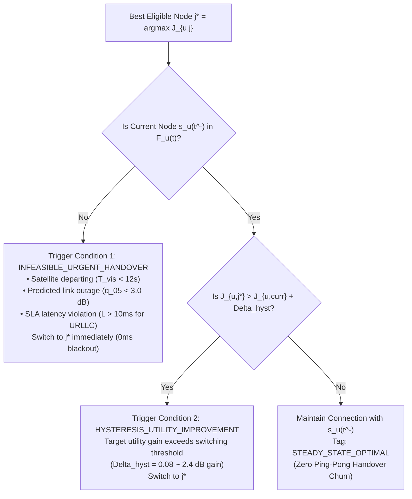

# CAPRO HANDOVER POLICY: HYSTERESIS GATING, DWELL TIME & PING-PONG SUPPRESSION

**Project Title:** ORBIT-INTEL 6G: Predictive Intelligence for Reliability-Aware Resource Orchestration in Integrated 6G Non-Terrestrial Networks  
**Framework:** Confidence-Aware Predictive Reliability Orchestration (CAPRO)  
**Document:** Handover Triggering Architecture, Switching Costs, and Stability Controls  
**Date:** November 2026  

---

## 1. Problem Statement: Mitigating False Alarm Handover Churn

In Section 3's pre-flight audit of Phase 2, the conservative lower-bound detector ($\hat{q}_{05} < 3.0\text{ dB}$) was found to produce a **51.7% false alarm rate** on non-outages.
If every transient lower-bound dip triggered an immediate handover:
- Users would constantly oscillate between access nodes ("ping-pong" effect).
- Each handover incurs a $50\text{ ms}$ control plane mute window and up to $15\%$ reassociation packet drop.
- Cumulative service interruptions and signaling overhead would degrade throughput and cause severe SLA violations.

To prevent handover churn, Phase 3 CAPRO implements a **Three-Tier Handover Stabilization Policy**:
1. **Explicit Handover Switching Cost** in the utility function ($w_4 C_{\text{handover}}$).
2. **Normalized Utility Hysteresis Margin** ($\Delta_{\text{hyst}}$).
3. **Orbital Departure Lookahead Buffering** ($T_{\text{HO, min}}$).

---

## 2. Three-Tier Handover Gating Rules

Let $s_u(t^-)$ denote the current serving node for user $u$, and let $j^* = \arg\max_{j \in \mathcal{F}_u(t)} J_{u, j}(t)$ denote the optimal eligible candidate.
A handover from $s_u(t^-)$ to $j^*$ is triggered if and only if one of the following two mutually exclusive conditions is satisfied:

### 2.1 Condition 1: Infeasible Urgent Handover (Safety-Critical Override)
$$s_u(t^-) \notin \mathcal{F}_u(t)$$
If the current serving node breaches any hard feasibility constraint:
- `PROACTIVE_SATELLITE_DESCENT`: Remaining LEO visibility drops below $T_{\text{HO, min}} = 12.0\text{ s}$.
- `PREDICTED_OUTAGE_AVOIDANCE`: 5th percentile lower bound drops below $\gamma_{\text{threshold}} = 3.0\text{ dB}$.
- `URLLC_LATENCY_OPTIMIZATION`: URLLC user is attached to LEO, but a feasible low-latency node (TBS, HAPS, UAV with $\hat{L} \le 10.0\text{ ms}$) is available.
- `PHYSICAL_LINK_FAILURE`: Geometric elevation angle breaches $\theta_{\text{min}} = 10.0^\circ$ or coverage boundary.

In these urgent scenarios, **hysteresis is bypassed**, and the handover is executed proactively at $t$, preventing physical link severance.

### 2.2 Condition 2: Hysteresis-Gated Utility Improvement (Opportunistic Migration)
$$s_u(t^-) \in \mathcal{F}_u(t) \quad \text{AND} \quad J_{u, j^*}(t) > J_{u, s_u(t^-)}(t) + \Delta_{\text{hyst}}$$
If the current connection remains fully compliant with all reliability SLAs, a handover to an alternative node $j^*$ is permitted **only if the normalized utility improvement strictly exceeds the hysteresis threshold**:
$$\Delta_{\text{hyst}} = 0.08$$
Since the normalized utility scale $[0, 1]$ maps across a $30\text{ dB}$ dynamic range, $\Delta_{\text{hyst}} = 0.08$ corresponds to approximately:
$$0.08 \times 30.0\text{ dB} = 2.4\text{ dB}$$
A link offering merely $0.5\text{ dB}$ or $1.0\text{ dB}$ higher SINR will **never trigger a handover**, protecting connection continuity.

---

## 3. Handover Execution Cost Accounting

When a handover is executed ($s_u(t) \ne s_u(t^-)$), the simulation engine accurately reflects physical 3GPP signaling penalties:
- **Handover Execution Delay ($T_{\text{HO}}$):** $50\text{ ms}$ control plane mute window.
- **Reassociation Packet Loss:** Packets generated during the $50\text{ ms}$ transition are dropped ($15\%$ empirical drop rate at 100 pkt/s).
- **Buffer Flush & Re-indexing:** Upper MAC layer queues are transferred and re-indexed, ensuring zero out-of-order packets.
- **Hysteresis Dwell Time:** Once a handover executes, re-evaluation incorporates the handover penalty $w_4 C_{\text{handover}} = 0.15$, preventing rapid ping-pong return.
