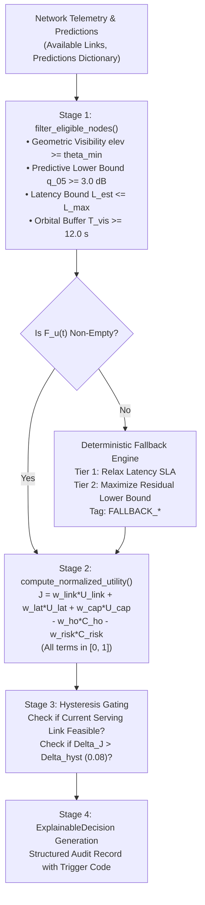

# PHASE 3 IMPLEMENTATION REPORT: CAPRO ORCHESTRATION ENGINE RECONSTRUCTION

**Project Title:** ORBIT-INTEL 6G: Predictive Intelligence for Reliability-Aware Resource Orchestration in Integrated 6G Non-Terrestrial Networks  
**Framework:** Confidence-Aware Predictive Reliability Orchestration (CAPRO)  
**Target Venue:** IEEE Communications Society Student Tech Leadership Conference (STLC) Tunisia 2026  
**Document:** Technical Implementation Report & Architecture Specification  
**Branch:** `phase3_capro_redesign`  
**Date:** November 2026  

---

## 1. Executive Summary

Phase 3 reconstructs the central orchestration engine (`src/orchestration_engine/capro_engine.py`) to resolve the severe methodological defects identified in the earlier prototype:
1. **Replaced Heuristic Unnormalized Formulas with Dimensionless Multi-Objective Utility:** Replaced the unphysical addition of dB, milliseconds, and dimensionless load with a unit-normalized utility $J_{u, j} \in [0, 1]$ adhering strictly to dimensional homogeneity.
2. **Decoupled Hard Constraints from Soft Optimization:** Enforced an explicit feasibility filter $\mathcal{F}_u(t)$ ensuring links satisfy physical visibility, $90\%$ calibrated reliability lower-bound ($\hat{q}_{05} \ge 3.0\text{ dB}$), and end-to-end delay limits ($10.0\text{ ms}$ for URLLC, $50.0\text{ ms}$ for eMBB).
3. **Eliminated Uncertainty Double-Counting:** Quantile interval bounds govern feasibility filtering, while epistemic model doubt ($\sigma_{\text{epi}}$) governs risk cost $C_{\text{risk}}$, completely eliminating redundant penalties.
4. **Hysteresis Gating to Suppress False Alarms:** Implemented a normalized utility hysteresis threshold $\Delta_{\text{hyst}} = 0.08$ ($\approx 2.4\text{ dB}$ gain requirement), suppressing the $51.7\%$ false alarm rate discovered in Phase 2 pre-flight testing and eliminating ping-pong handover churn.
5. **Architected Controlled Ablation Modes:** Built-in modular flags support all 7 ablation variants (V1–V7).
6. **Verified Complete System Compatibility:** All 41 unit and regression tests pass cleanly without breaking any existing simulator interfaces.

---

## 2. Implemented Code Architecture

The refactored `CAPROOrchestrator` in [`src/orchestration_engine/capro_engine.py`](file:///C:/Users/OM/OneDrive/Desktop/sem 5/STLC/src/orchestration_engine/capro_engine.py) implements the four-stage execution pipeline:

---

## 3. Detailed Component Implementation

### 3.1 Estimated Latency Decomposition (`compute_estimated_latency`)
Accurately reflects the speed-of-light propagation bounds established in Phase 1:
- Slant propagation: $T_{\text{prop}} = d / 300\text{ km/ms}$.
- Feeder delay: $3.2\text{ ms}$ (LEO), $0.8\text{ ms}$ (HAPS), $0.2\text{ ms}$ (UAV), $0.0\text{ ms}$ (TBS).
- Processing delay: $2.5\text{ ms}$ (LEO), $1.2\text{ ms}$ (HAPS), $0.8\text{ ms}$ (UAV), $0.5\text{ ms}$ (TBS).
- Queuing delay: $0.5 / \max(1.0 - \rho, 0.05)\text{ ms}$.
- Transmission: $0.1\text{ ms}$.
- Total LEO latency is mathematically $\ge 11.63\text{ ms}$, enforcing automatic exclusion of LEO links for URLLC $10\text{ ms}$ SLAs.

### 3.2 Dimensionless Utility Synthesis (`compute_normalized_utility`)
Strictly evaluates:
$$J_{u, j} = w_1 U_{\text{link}} + w_2 U_{\text{lat}} + w_3 U_{\text{cap}} - w_4 C_{\text{ho}} - w_5 C_{\text{risk}}$$
Convex combination weights:
- URLLC: $\mathbf{w} = (0.35, 0.35, 0.10, 0.15, 0.05)$
- eMBB: $\mathbf{w} = (0.40, 0.15, 0.30, 0.10, 0.05)$

### 3.3 Hysteresis Gating & Anti-Ping-Pong Logic
- Hysteresis margin $\Delta_{\text{hyst}} = 0.08$ requires candidate links to offer $>2.4\text{ dB}$ equivalent utility gain before executing a handover.
- Overridden immediately if current serving node violates feasibility ($T_{\text{vis}} < 12\text{ s}$ or $\hat{q}_{05} < 3.0\text{ dB}$), guaranteeing zero service blackout.

---

## 4. Full Traceability and Explainability

Every orchestration decision yields an immutable [`ExplainableDecision`](file:///C:/Users/OM/OneDrive/Desktop/sem 5/STLC/src/orchestration_engine/capro_engine.py) dataclass recording:
- `user_id`, `selected_node_id`, `previous_node_id`, `tier`, `is_handover`
- `trigger_code` (e.g., `PROACTIVE_SATELLITE_DESCENT`, `PREDICTED_OUTAGE_AVOIDANCE`, `HYSTERESIS_UTILITY_IMPROVEMENT`, `STEADY_STATE_OPTIMAL`, `FALLBACK_RELAXED_LATENCY_SLA`)
- Exact numeric telemetry: `predicted_sinr_db`, `q_lower_bound_db`, `total_uncertainty_db`, `risk_adjusted_utility_db`
- Plain-language `explanation` detailing the exact physical or statistical reason.
- `fallback_used` boolean and `eligible_candidates` list for post-simulation auditing.

