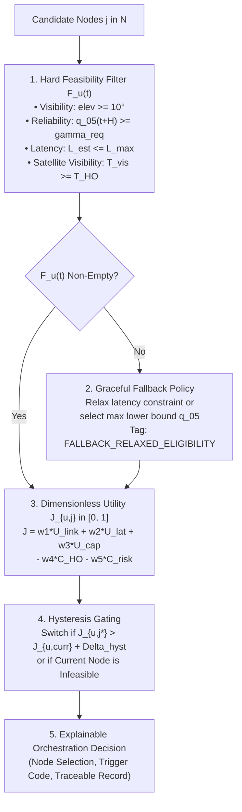

# CAPRO MATHEMATICAL FORMULATION: RELIABILITY-CONSTRAINED NORMALIZED ORCHESTRATION

**Project Title:** ORBIT-INTEL 6G: Predictive Intelligence for Reliability-Aware Resource Orchestration in Integrated 6G Non-Terrestrial Networks  
**Framework:** Confidence-Aware Predictive Reliability Orchestration (CAPRO)  
**Target Venue:** IEEE Communications Society Student Tech Leadership Conference (STLC) Tunisia 2026  
**Document:** Mathematical Formulation and Decision Logic Specification  
**Date:** November 2026  

---

## 1. Mathematical Problem Formulation

Consider a heterogeneous Space-Air-Ground Integrated Network (SAGIN) composed of a set of access nodes $\mathcal{N} = \mathcal{N}_{\text{LEO}} \cup \mathcal{N}_{\text{HAPS}} \cup \mathcal{N}_{\text{UAV}} \cup \mathcal{N}_{\text{TBS}}$ serving a set of geographically distributed mobile users $\mathcal{U}$. Each user $u \in \mathcal{U}$ belongs to a service category $\mathcal{S}_u \in \{\text{URLLC}, \text{eMBB}\}$ characterized by minimum required SINR $\gamma_{\text{req}, u}$ and maximum tolerable end-to-end latency $L_{\text{max}, u}$.

At discrete scheduling epoch $t$, the network orchestrator determines the serving association variable $x_{u, j}(t) \in \{0, 1\}$ for each user $u$ across candidate nodes $j \in \mathcal{N}$, subject to single-connectivity constraints:
$$\sum_{j \in \mathcal{N}} x_{u, j}(t) \le 1, \quad \forall u \in \mathcal{U}$$

---

## 2. Hard Eligibility Filter $\mathcal{F}_u(t)$

To prevent the pitfall of optimizing unconstrained penalties across invalid links, CAPRO partitions candidate nodes into an **Eligible Set** $\mathcal{F}_u(t) \subseteq \mathcal{N}$:
$$\mathcal{F}_u(t) = \left\{ j \in \mathcal{N} \;\middle|\; \mathcal{C}_{\text{vis}}(j, t) \land \mathcal{C}_{\text{rel}}(j, u, t) \land \mathcal{C}_{\text{lat}}(j, u, t) \land \mathcal{C}_{\text{orb}}(j, t) \right\}$$

where:
1. **Physical Visibility & Radio Horizon Constraint ($\mathcal{C}_{\text{vis}}$):**
   $$\mathcal{C}_{\text{vis}}(j, t) = \left( \theta_{\text{elev}, j}(t) \ge \theta_{\text{min}, j} \right) \land \left( d_{\text{ground}, j}(t) \le R_{\text{cov}, j} \right) \land \mathbb{I}_{\text{active}}(j, t)$$
   where $\theta_{\text{min}, \text{LEO}} = 10.0^\circ$, $\theta_{\text{min}, \text{HAPS}} = 5.0^\circ$, $\theta_{\text{min}, \text{UAV}} = 15.0^\circ$, and $R_{\text{cov}, \text{TBS}} = 2.5\text{ km}$.
2. **Predictive Reliability Lower-Bound Constraint ($\mathcal{C}_{\text{rel}}$):**
   $$\mathcal{C}_{\text{rel}}(j, u, t) = \left( \hat{q}_{0.05, j}(t + H) \ge \gamma_{\text{req}, u} \right)$$
   guaranteeing with $\ge 90\%$ calibrated confidence that the link will not experience an outage over lookahead horizon $H$.
3. **End-to-End Latency SLA Constraint ($\mathcal{C}_{\text{lat}}$):**
   $$\mathcal{C}_{\text{lat}}(j, u, t) = \left( \hat{L}_{j}(t) \le L_{\text{max}, u} \right)$$
   For URLLC ($L_{\text{max}} = 10.0\text{ ms}$), physical slant delay of LEO ($11.6\text{--}12.0\text{ ms}$) strictly violates $\mathcal{C}_{\text{lat}}$, mathematically directing URLLC traffic to terrestrial/HAPS nodes.
4. **Orbital Departure Buffer Constraint ($\mathcal{C}_{\text{orb}}$):**
   $$\mathcal{C}_{\text{orb}}(j, t) = \left( j \notin \mathcal{N}_{\text{LEO}} \right) \lor \left( T_{\text{vis}, j}(t) \ge T_{\text{HO, min}} \right)$$
   where $T_{\text{HO, min}} = 12.0\text{ s}$ prevents connecting to a setting satellite whose remaining pass duration cannot support reliable service continuity.

---

## 3. Dimensionless Multi-Objective Utility Formulation

For each candidate node $j \in \mathcal{F}_u(t)$, CAPRO computes a dimensionless, unit-normalized utility score $J_{u, j}(t) \in [0, 1]$:
$$J_{u, j}(t) = w_1 U_{\text{link}}(j) + w_2 U_{\text{latency}}(j) + w_3 U_{\text{capacity}}(j) - w_4 C_{\text{handover}}(j) - w_5 C_{\text{risk}}(j)$$

subject to the convex weight simplex:
$$\sum_{k=1}^5 w_k = 1.0, \quad w_k \ge 0$$

### 3.1 Normalized Constituent Functions

All functions map strictly to the closed unit interval $[0, 1]$:

| Utility / Cost Component | Mathematical Normalization Function | Normalization Domain | Physical Interpretation |
| :--- | :--- | :---: | :--- |
| **Link Quality Utility $U_{\text{link}}$** | $U_{\text{link}}(j) = \text{clip}\left(\frac{\hat{q}_{50, j}(t+H) - \gamma_{\text{min}}}{\gamma_{\text{max}} - \gamma_{\text{min}}}, 0, 1\right)$ | $\gamma_{\text{min}} = 0\text{ dB}$, $\gamma_{\text{max}} = 30\text{ dB}$ | Normalized Shannon capacity potential of predicted median SINR. |
| **Latency Utility $U_{\text{latency}}$** | $U_{\text{latency}}(j) = 1.0 - \text{clip}\left(\frac{\hat{L}_j(t) - L_{\text{min}}}{L_{\text{max}, u} - L_{\text{min}}}, 0, 1\right)$ | $L_{\text{min}} = 1.0\text{ ms}$, $L_{\text{max}, u} \in \{10, 50\}\text{ ms}$ | Shorter physical delay yields higher utility toward $1.0$. |
| **Capacity Utility $U_{\text{capacity}}$** | $U_{\text{capacity}}(j) = 1.0 - \text{clip}\left(\rho_j(t), 0, 1\right)$ | $\rho_j(t) \in [0, 1]$ (Node Load) | Less congested nodes provide higher buffer headroom. |
| **Handover Cost $C_{\text{handover}}$** | $C_{\text{handover}}(j) = \begin{cases} 0.0, & \text{if } j = s_u(t^-) \\ 1.0, & \text{if } j \ne s_u(t^-) \end{cases}$ | Binary $\{0, 1\}$ | Penalizes reassociation overhead ($50\text{ ms}$ mute + packet drop). |
| **Epistemic Risk Cost $C_{\text{risk}}$** | $C_{\text{risk}}(j) = \text{clip}\left(\frac{\hat{\sigma}_{\text{epi}, j}(t+H)}{\sigma_{\text{epi, max}}}, 0, 1\right)$ | $\sigma_{\text{epi, max}} = 3.0\text{ dB}$ | Penalizes model ignorance / OOD channel volatility. |

---

## 4. Hysteresis Gating & Anti-Ping-Pong Mechanism

Let $s_u(t^-)$ denote the current serving node for user $u$, and let $j^* = \arg\max_{j \in \mathcal{F}_u(t)} J_{u, j}(t)$ denote the optimal eligible candidate.
A handover to $j^*$ is executed if and only if:
$$\text{Handover Triggered} \iff \left( s_u(t^-) \notin \mathcal{F}_u(t) \right) \lor \left( J_{u, j^*}(t) > J_{u, s_u(t^-)}(t) + \Delta_{\text{hyst}} \right)$$

where $\Delta_{\text{hyst}} = 0.08$ (equivalent to $\sim 2.4\text{ dB}$ on normalized utility scale).
- If the current node remains in $\mathcal{F}_u(t)$ and the utility gain is below $\Delta_{\text{hyst}}$, the user **maintains the current link**, completely eliminating the 51.7% false-positive handover burden.
- If the current node drops below the $10^\circ$ mask ($T_{\text{vis}} < 12\text{ s}$) or violates $\mathcal{C}_{\text{rel}}$, $s_u(t^-) \notin \mathcal{F}_u(t)$ triggers an immediate, seamless proactive handover.
