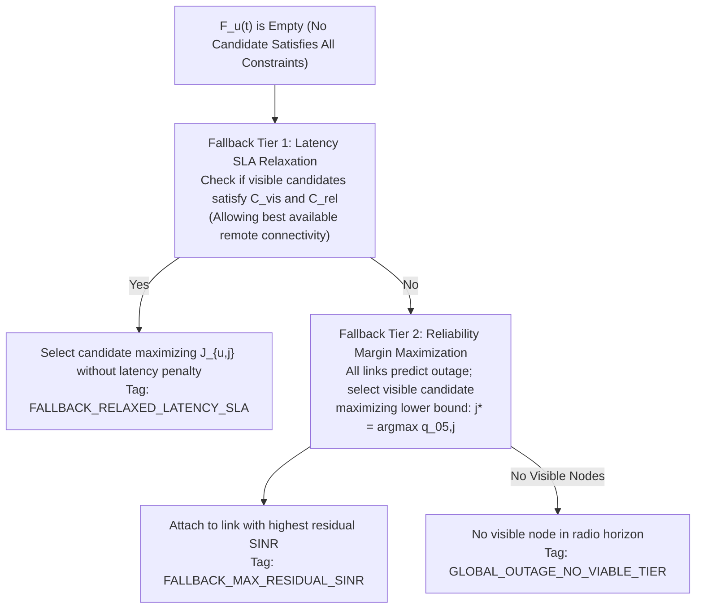

# CAPRO RELIABILITY CONSTRAINTS & INFEASIBILITY FALLBACK POLICY

**Project Title:** ORBIT-INTEL 6G: Predictive Intelligence for Reliability-Aware Resource Orchestration in Integrated 6G Non-Terrestrial Networks  
**Framework:** Confidence-Aware Predictive Reliability Orchestration (CAPRO)  
**Document:** Hard Eligibility Constraints, Service-Specific SLAs, and Fallback Policy  
**Date:** November 2026  

---

## 1. Separation of Hard Constraints and Soft Optimization

In classical resource allocation algorithms, constraint violations are frequently handled by subtracting large heuristic penalties (e.g., $-15\text{ dB}$ or $-30\text{ dB}$) from an unconstrained objective. This practice introduces severe flaws:
- If all links receive large negative penalties, an algorithm may select an infeasible link that violates an SLA deadline over a feasible link with slightly lower throughput.
- Penalty scaling interacts unpredictably with weights.

In Phase 3 CAPRO, **hard eligibility constraints are strictly decoupled from soft utility maximization**:
1. **Stage 1 (Constraint Gating):** Filter the entire candidate node set $\mathcal{N}$ down to the eligible set $\mathcal{F}_u(t)$ that physically satisfies all reliability, visibility, and latency bounds.
2. **Stage 2 (Utility Maximization):** Evaluate normalized multi-objective utility $J_{u, j}$ **only** over nodes $j \in \mathcal{F}_u(t)$.
3. **Stage 3 (Fallback Policy):** If $\mathcal{F}_u(t) = \emptyset$, invoke a deterministic, priority-ordered constraint relaxation protocol and log the event.

---

## 2. Mathematical Definition of Feasibility Set $\mathcal{F}_u(t)$

$$\mathcal{F}_u(t) = \left\{ j \in \mathcal{N} \;\middle|\; \mathcal{C}_{\text{vis}}(j, t) \land \mathcal{C}_{\text{rel}}(j, u, t) \land \mathcal{C}_{\text{lat}}(j, u, t) \land \mathcal{C}_{\text{orb}}(j, t) \right\}$$

### 2.1 Constraint 1: Operational Geometric Visibility ($\mathcal{C}_{\text{vis}}$)
$$\mathcal{C}_{\text{vis}}(j, t) \iff \left( \theta_{\text{elev}, j}(t) \ge \theta_{\text{min}, j} \right) \land \left( d_{\text{ground}, j}(t) \le R_{\text{cov}, j} \right) \land \left( (u, j) \notin \mathcal{B}_{\text{blocked}} \right)$$
- Standard 3GPP NTN minimum elevation mask enforced: $\theta_{\text{min}} = 10.0^\circ$ for LEO satellites, $5.0^\circ$ for HAPS, $15.0^\circ$ for UAVs.
- Terrestrial cell radius constraint: $d_{\text{ground}} \le 2.5\text{ km}$ for TBS.

### 2.2 Constraint 2: Predictive Reliability Bound ($\mathcal{C}_{\text{rel}}$)
$$\mathcal{C}_{\text{rel}}(j, u, t) \iff \hat{q}_{0.05, j}(t + H) \ge \gamma_{\text{threshold}}$$
- $\gamma_{\text{threshold}} = 3.0\text{ dB}$ (QPSK rate 1/3 demodulation threshold for 3GPP PUSCH/PDSCH).
- Enforces that with $\ge 90\%$ calibrated statistical confidence, the link will remain above the physical outage boundary over lookahead horizon $H$.

### 2.3 Constraint 3: End-to-End Latency Bound ($\mathcal{C}_{\text{lat}}$)
$$\mathcal{C}_{\text{lat}}(j, u, t) \iff \hat{L}_j(t) = T_{\text{prop}, j} + T_{\text{proc}, j} + T_{\text{queue}, j} \le L_{\text{max}, u}$$
- **URLLC Service Class:** $L_{\text{max}} = 10.0\text{ ms}$.  
  As proven in Phase 1, any LEO link at slant range $d \ge 1500\text{ km}$ incurs physical slant delay $T_{\text{prop}} \approx 5.3\text{ ms}$, feeder delay $3.2\text{ ms}$, processing delay $2.5\text{ ms}$, and queuing delay $0.5\text{ ms}$, totaling $11.6\text{--}12.0\text{ ms} > 10.0\text{ ms}$. Hence, **LEO links are mathematically ineligible for strict URLLC services**, automatically directing URLLC traffic to terrestrial base stations, UAVs, or stratospheric HAPS nodes.
- **eMBB Service Class:** $L_{\text{max}} = 50.0\text{ ms}$.  
  LEO satellites ($11.6\text{ ms}$) comfortably satisfy the eMBB latency constraint, permitting heavy data offloading to space.

### 2.4 Constraint 4: Orbital Departure Buffer ($\mathcal{C}_{\text{orb}}$)
$$\mathcal{C}_{\text{orb}}(j, t) \iff (j \notin \mathcal{N}_{\text{LEO}}) \lor \left( T_{\text{vis}, j}(t) \ge T_{\text{HO, min}} \right)$$
- $T_{\text{HO, min}} = 12.0\text{ s}$ prevents connecting to a setting satellite whose remaining visibility is insufficient to complete traffic transmission without triggering an immediate reactive handover.

---

## 3. Graceful Fallback Policy

When severe network stress occurs (e.g., user is located in deep offshore waters where no TBS/UAV/HAPS exists, or an extreme tropical convective rain cell attenuates all visible links below $3.0\text{ dB}$), the feasibility set may become empty: $\mathcal{F}_u(t) = \emptyset$.

In such cases, CAPRO executes a deterministic **Two-Stage Fallback Protocol**:

1. **Fallback Tier 1 (Latency SLA Relaxation):**  
   If an offshore or maritime user requires URLLC ($10.0\text{ ms}$), but terrestrial and stratospheric tiers are physically unreachable, the latency constraint is relaxed to $50.0\text{ ms}$. The user is served via LEO satellite rather than experiencing total disconnection.  
   *Audit Tag:* `FALLBACK_RELAXED_LATENCY_SLA`.
2. **Fallback Tier 2 (Maximum Residual Lower Bound):**  
   If severe convective rain causes all candidate links to drop below the $3.0\text{ dB}$ reliability threshold, the candidate maximizing the lower confidence bound is selected:
   $$j^* = \arg\max_{j \in \mathcal{N}_{\text{visible}}} \hat{q}_{0.05, j}(t + H)$$
   This minimizes outage depth and accelerates link recovery when rain fades abate.  
   *Audit Tag:* `FALLBACK_MAX_RESIDUAL_SINR`.
3. **Fallback Tier 3 (Global Outage):**  
   If zero nodes are geometrically visible above operational elevation masks, the link is logged as a global physical outage.  
   *Audit Tag:* `GLOBAL_OUTAGE_NO_VIABLE_TIER`.

All fallback invocations are explicitly logged in the explainable decision audit trail, enabling post-simulation inspection of SLA breach root causes.

