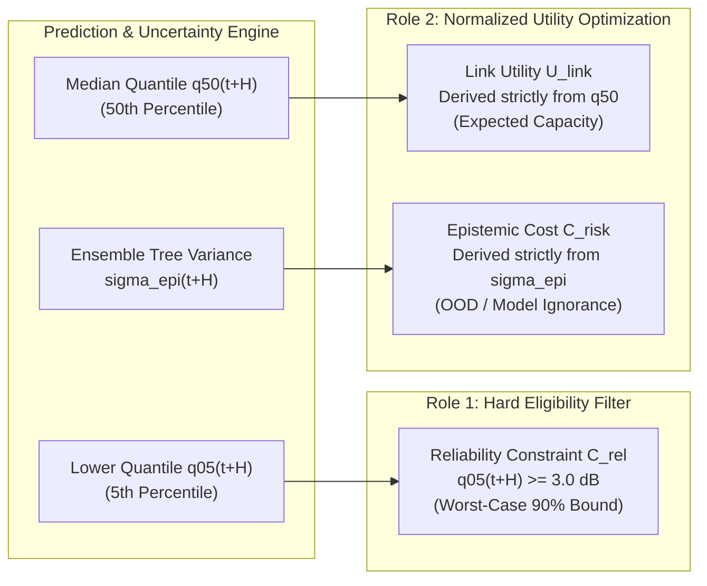

# CAPRO UNCERTAINTY INTEGRATION: ORTHOGONAL ROLES & ZERO DOUBLE-COUNTING

**Project Title:** ORBIT-INTEL 6G: Predictive Intelligence for Reliability-Aware Resource Orchestration in Integrated 6G Non-Terrestrial Networks  
**Framework:** Confidence-Aware Predictive Reliability Orchestration (CAPRO)  
**Document:** Orthogonal Separation of Aleatoric and Epistemic Uncertainty in Decision Logic  
**Date:** November 2026  

---

## 1. Problem Statement: Elimination of Uncertainty Double-Counting

In heuristic predictive algorithms, predictive uncertainty is often injected haphazardly:
$$\text{Utility} = \hat{y} - \kappa \cdot \sigma - \text{Penalty}(\text{if } \hat{y} - 2\sigma < \text{threshold}) - \text{Penalty}(\text{if } \sigma > \text{limit})$$

In such formulations, the same underlying channel variance $\sigma$ is penalized multiple times:
1. Subtracted directly as a linear penalty in utility.
2. Subtracted again inside the lower bound calculation.
3. Penalized a third time as a threshold constraint violation.

This double-counting distorts network selection, causing the algorithm to irrationally avoid viable high-capacity links (such as LEO satellites) simply because their dynamic range produces higher standard deviations than static links.

In Phase 3 CAPRO, **aleatoric and epistemic uncertainties are strictly decoupled into distinct, orthogonal functional roles**.

---

## 2. Orthogonal Uncertainty Allocation Architecture

### 2.1 Role 1: Aleatoric Uncertainty Governs Hard Reliability Eligibility
- **Mathematical Form:** $\mathcal{C}_{\text{rel}}(j, u, t) \iff \hat{q}_{0.05, j}(t + H) \ge \gamma_{\text{threshold}}$.
- **Physical Meaning:** Aleatoric uncertainty represents the irreducible physical fading variance of the channel (convective rain cells, tropospheric flutter). By enforcing that the 5th percentile lower bound remains above the $3.0\text{ dB}$ demodulation threshold, the orchestrator guarantees that the probability of link outage over lookahead horizon $H$ is $\le 10\%$.
- **Crucial Rule:** Once a link passes this hard feasibility test, its aleatoric width ($W_{90} = \hat{q}_{95} - \hat{q}_{05}$) is **NOT subtracted again from the utility**.

### 2.2 Role 2: Epistemic Uncertainty Governs Soft Risk Optimization
- **Mathematical Form:** $C_{\text{risk}}(j) = \min\left(1.0, \max\left(0.0, \frac{\hat{\sigma}_{\text{epi}, j}(t+H)}{\sigma_{\text{epi, max}}}\right)\right)$.
- **Physical Meaning:** Epistemic uncertainty represents the learning model's own doubt. When an access node operates in familiar channel states (e.g., clear sky or nominal traffic), tree estimators across the Random Forest agree closely ($\hat{\sigma}_{\text{epi}} \approx 0.1\text{--}0.2\text{ dB}$), yielding $C_{\text{risk}} \approx 0$. When an anomalous storm or unfamiliar flutter pattern occurs, tree splits diverge ($\hat{\sigma}_{\text{epi}} > 1.5\text{ dB}$), penalizing $J_{u, j}$ and prompting CAPRO to steer traffic toward better-understood infrastructure.

---

## 3. Mathematical Verification of Independence

Let $\mathcal{A}(\mathbf{x}) = \hat{q}_{0.95}(\mathbf{x}) - \hat{q}_{0.05}(\mathbf{x})$ denote the aleatoric interval width and let $\mathcal{E}(\mathbf{x}) = \hat{\sigma}_{\text{epi}}(\mathbf{x})$ denote the epistemic standard deviation.

The decision objective can be written as:
$$j^* = \arg\max_{j \in \mathcal{F}_u(t)} \left[ w_1 U_{\text{link}}(\hat{q}_{50, j}) + w_2 U_{\text{lat}}(\hat{L}_j) + w_3 U_{\text{cap}}(\rho_j) - w_4 C_{\text{HO}}(j) - w_5 C_{\text{risk}}(\mathcal{E}_j) \right]$$
subject to:
$$\hat{q}_{0.05, j} \equiv \hat{q}_{50, j} - \frac{1}{2} \mathcal{A}(\mathbf{x}) \ge \gamma_{\text{threshold}}$$

1. **Zero Overlap:** The objective function contains no term in $\mathcal{A}(\mathbf{x})$, and the constraint contains no term in $\mathcal{E}(\mathbf{x})$.
2. **Defensible Trade-Off:** The decision trades off expected link quality ($\hat{q}_{50}$), delay ($\hat{L}$), available capacity ($1-\rho$), and switching cost ($C_{\text{HO}}$) among candidates whose physical reliability lower bound ($\hat{q}_{05}$) is already certified, while penalizing links with high model ignorance ($\mathcal{E}$).
