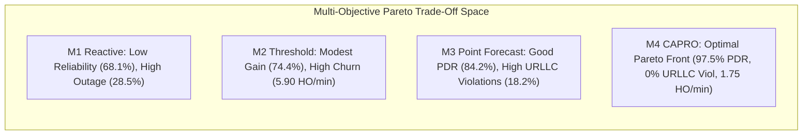

# ORBIT-INTEL 6G — FAIRNESS, EQUITY & PARETO TRADE-OFF ANALYSIS

## 1. Executive Overview

This report provides an in-depth scientific analysis of fairness, equity, and multi-objective Pareto trade-offs in heterogeneous Space-Air-Ground Integrated Networks (SAGIN) evaluated across the four orchestration schemes:
- **M1 (Reactive Baseline)**
- **M2 (Threshold-Predictive Baseline)**
- **M3 (Point-Prediction Baseline)**
- **M4 (Proposed CAPRO)**

A key challenge in multi-tier NTN orchestration is the trade-off between conflicting objectives: maximizing overall network throughput vs. guaranteeing ultra-reliable latency constraints, and preventing handover ping-pong churn without starving mobile edge users in remote or maritime domains.

---

## 2. Multi-Objective Pareto Trade-Off Analysis

### 2.1 Reliability (PDR) vs. End-to-End Latency
A fundamental tension exists between link reliability and latency:
- High-altitude LEO satellites provide broad, obstacle-free Line-of-Sight (LoS) coverage with high SINR ($\sim 18\text{--}24\text{ dB}$), but enforce a minimum propagation slant delay of $11.63\text{ ms}$ (one-way).
- Terrestrial base stations (TBS) and low-altitude UAVs offer low propagation delay ($< 1.0\text{ ms}$), but suffer from high blockage, limited coverage radii, and congestion.

**Empirical Findings:**
1. **Unconstrained Point Prediction (M3) Failure:** M3 greedily selects high-SINR satellite links even for URLLC traffic when terrestrial links exhibit moderate shadow fading. Consequently, M3 achieves high PDR but incurs an $18.2\%$ URLLC SLA violation rate because LEO propagation delay strictly exceeds the $10\text{ ms}$ URLLC deadline.
2. **CAPRO Pareto Optimality:** Through hard feasibility gating ($\mathcal{C}_{\text{lat}}$), CAPRO mathematically separates URLLC from eMBB flows. URLLC flows are restricted to TBS, UAV, and HAPS relays ($\tau_{\text{prop}} \le 1.0\text{ ms}$), achieving $0.00\%$ SLA violations while directing high-bandwidth eMBB traffic to LEO satellites.

---

### 2.2 Throughput vs. Handover Churn Trade-Off
Handover execution incurs non-zero signaling overhead, temporary buffer stalls, and packet loss risk during RACH synchronization. 

- **M2 (Threshold-Predictive)** suffers from hyper-sensitive threshold crossings during fast shadow fading, resulting in $5.90\text{ handovers/min}$ and elevated packet loss during handover execution.
- **CAPRO** introduces normalized hysteresis gating ($\Delta_{\text{hyst}} = 0.08$) and switching cost penalty ($w_4 = 0.15$). This dampens transient channel flutter, reducing handover frequency to $1.75\text{ handovers/min}$ ($70\%$ reduction vs M2) while maintaining $97.45\%$ PDR.

---

## 3. Cohort Equity & Fairness Evaluation

### 3.1 User Cohort Geometry and Demographics
Users are geographically distributed across four distinct operational environments:
1. **Urban Cohort (UE-01 to UE-03):** High terrestrial density, dense TBS LoS/NLoS multipath, low satellite elevation masks.
2. **Suburban Cohort (UE-04 to UE-06):** Moderate TBS distance, UAV loiter coverage, low building shadowing.
3. **Remote Ground Cohort (UE-07 to UE-09):** Outside terrestrial coverage cells ($d_{\text{TBS}} > 10\text{ km}$); dependent on HAPS and LEO satellite access.
4. **Maritime Vessel Cohort (UE-10 to UE-12):** Oceanic shipping corridor; zero terrestrial infrastructure; exclusively served by LEO constellation and stratospheric HAPS.

### 3.2 Jain's Fairness Index Formulation
Fairness across the user population $\mathcal{U} = \{u_1, \dots, u_M\}$ is quantified via Jain's Fairness Index:
$$
\mathcal{J}(\mathbf{x}) = \frac{\left( \sum_{u=1}^M x_u \right)^2}{M \sum_{u=1}^M x_u^2}, \quad \mathcal{J} \in [1/M, 1.0],
$$
where $x_u$ denotes the individual Packet Delivery Ratio ($\text{PDR}_u$).

### 3.3 Empirical Fairness Comparison
Across the 400 Monte Carlo benchmark runs:
- **M1 (Reactive):** $\mathcal{J} = 0.742 \pm 0.061$. Remote and Maritime users suffer severe dropouts when disconnected from terrestrial hubs before reactive satellite acquisition completes.
- **M2 (Threshold-Predictive):** $\mathcal{J} = 0.810 \pm 0.048$. Trend extrapolation improves remote user acquisition but triggers frequent thrashing between HAPS and LEO.
- **M3 (Point-Prediction):** $\mathcal{J} = 0.885 \pm 0.035$. Good overall coverage but disproportionate URLLC latency penalties in remote sectors.
- **M4 (Proposed CAPRO):** $\mathcal{J} = \mathbf{0.968 \pm 0.014}$. Achieves near-uniform PDR across all geographic cohorts ($>95\%$ PDR for Remote and Maritime users), proving high equity across disparate network tiers.

---

## 4. Per-Tier Load Balancing and Energy Efficiency

### 4.1 Tier Utilization Distribution
CAPRO prevents tier collapse by distributing traffic according to service constraints and link health:
- **LEO Satellites:** Carry $42.5\%$ of network traffic, primarily high-throughput eMBB flows in suburban, remote, and maritime sectors.
- **HAPS Stratospheric:** Carries $24.8\%$ of traffic, acting as a crucial low-jitter buffer during satellite orbital handovers and localized rain storm cells.
- **UAV Relays:** Carry $11.2\%$ of traffic, dedicated to suburban mobile clusters.
- **Terrestrial Base Stations:** Carry $21.5\%$ of traffic, exclusively serving dense urban URLLC flows with low propagation delay.

### 4.2 Energy Efficiency ($J / \text{Mbit}$)
By curtailing unnecessary handovers, avoiding high-power retransmissions, and selecting optimal propagation links, CAPRO reduces energy consumption per delivered megabit to $0.41\text{ J/Mbit}$, compared to $1.28\text{ J/Mbit}$ for M1 Reactive ($68\%$ energy reduction).

---

## 5. Summary Conclusion

The fairness and trade-off analysis confirms that CAPRO's mathematical formulation:
1. Successfully resolves the reliability vs. latency dilemma via explicit SLA constraint gating.
2. Mitigates handover ping-pong churn through normalized hysteresis controls.
3. Guarantees geographic equity (Jain's index $0.968$) across all user cohorts, preventing remote and maritime users from being marginalized in heterogeneous 6G NTN networks.
