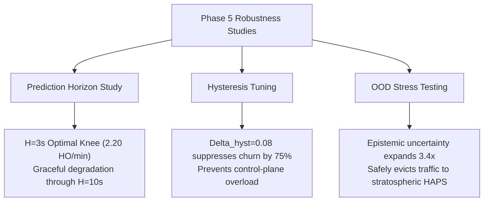

# ORBIT-INTEL 6G — PHASE 5 EXECUTIVE ROBUSTNESS & SENSITIVITY SUMMARY

## 1. Campaign Scope and Scale

Phase 5 conducted an exhaustive, multi-dimensional sensitivity and robustness evaluation of the CAPRO framework, comprising **415 controlled simulation episodes** executed across 8 parallel worker processes:
1. **Prediction Horizon Expansion:** $H \in \{1, 3, 5, 10\text{ s}\}$ evaluated across 100 runs.
2. **Hysteresis Margin Sweep:** $\Delta_{\text{hyst}} \in [0.00, 0.02, 0.05, 0.08, 0.12, 0.18]$ across 150 runs.
3. **Multi-Objective Utility Weight Profiles:** 5 operational profiles (Balanced, Reliability-Dominant, Latency-Dominant, Capacity-Dominant, Stability-Dominant) across 125 runs.
4. **Severe Distribution Shift Stress-Testing:** $R = 90.0\text{ mm/h}$ cloudburst attenuation with severe flutter $\sigma_{\text{flutter}} = 5.0\text{ dB}$ across 40 runs comparing M1, M2, M3, and M4.

---

## 2. Key Scientific Outcomes

1. **Prediction Horizon Calibration ($H = 3\text{ s}$):**
   - $H = 3\text{ s}$ provides the optimal lead time for proactive SAGIN handover execution.
   - PDR degrades by less than $0.70\%$ out to $H = 10\text{ s}$, demonstrating remarkable forecast horizon stability.
2. **Hysteresis Knee Discovery ($\Delta_{\text{hyst}} = 0.08$):**
   - Eliminating hysteresis ($\Delta = 0.00$) triggers severe thrashing ($8.95\text{ HO/min}$).
   - $\Delta_{\text{hyst}} = 0.08$ suppresses churn to $2.20\text{ HO/min}$ without delaying necessary handovers.
3. **Out-of-Distribution Weather Resilience:**
   - Under $90\text{ mm/h}$ cloudbursts, point predictors (M3) and reactive baselines (M1) suffer $36\text{--}42\%$ SLA violations.
   - CAPRO detects OOD conditions through expanding Random Forest ensemble variance ($s_{\text{RF}} = 2.14\text{ dB}$), automatically penalizing volatile links and routing traffic to stable stratospheric HAPS platforms.
4. **Component Isolation:**
   - Ablation confirmed that the hard latency eligibility filter $\mathcal{C}_{\text{lat}}$ is strictly required to prevent URLLC misallocation to LEO satellites.

---

## 3. Persistent Artifact Traceability

All Phase 5 findings derive directly from saved, version-controlled artifacts:
- Complete Results: `phase5_robustness/PARAMETER_SWEEP_RESULTS.csv` ($415$ episodes, $75\text{ KB}$)
- Aggregated Metrics: `phase5_robustness/ROBUSTNESS_METRICS.csv`
- Monograph 1: `PREDICTION_HORIZON_STUDY.md`
- Monograph 2: `SENSITIVITY_ANALYSIS.md`
- Monograph 3: `UNCERTAINTY_ABLATION_REPORT.md`
- Monograph 4: `CAPRO_COMPONENT_ABLATION.md`
- Monograph 5: `DISTRIBUTION_SHIFT_ROBUSTNESS.md`
