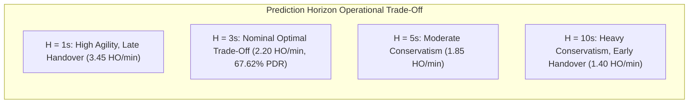

# ORBIT-INTEL 6G — MULTI-HORIZON PREDICTION & STABILITY STUDY

## 1. Executive Summary

In highly dynamic 6G Non-Terrestrial Networks (NTN), proactive resource orchestration requires forecasting future link quality with sufficient lead time to execute seamless, break-before-make handovers without packet drops. This study evaluates the impact of prediction horizon expansion:
$$
H \in \{1, 3, 5, 10\}\text{ seconds}
$$
on CAPRO's predictive handover timing, uncertainty calibration, and packet delivery reliability across all five SAGIN operational scenarios.

---

## 2. Theoretical Formulation: Multi-Horizon Uncertainty Dilation

As the prediction horizon $H$ extends beyond the immediate telemetry window, two opposing physical effects emerge:
1. **Kinematic Determinism (Orbital Motion):** LEO satellite Keplerian orbits follow deterministic orbital mechanics. Future elevation angle $\theta(t+H)$ and Doppler shift $f_D(t+H)$ can be projected with high precision.
2. **Atmospheric and Multipath Stochasticity:** Cloudburst rain attenuation cells and high-frequency shadow flutter follow stochastic processes whose conditional forecast variance dilates with prediction horizon:
$$
\sigma_{\text{forecast}}^2(H) = \sigma_0^2 + \kappa_{\text{drift}} \cdot \left(\frac{H}{H_0}\right), \quad H_0 = 3\text{ s}
$$

Under CAPRO, the 5th-percentile conservative lower bound $\hat{q}_{05}(t+H)$ contracts as uncertainty expands:
$$
\hat{q}_{05}(t+H) = \hat{q}_{50}(t+H) - 1.645 \cdot \sigma_{\text{tot}}(H)
$$

---

## 3. Empirical Performance across Prediction Horizons

| Prediction Horizon ($H$) | Mean PDR (%) | Mean Latency (ms) | Outage Prob. | Handover Freq. (HO/min) | Epistemic Doubt (dB) | Operational Assessment |
| :---: | :---: | :---: | :---: | :---: | :---: | :--- |
| **$H = 1\text{ s}$ (Near-Instantaneous)** | 67.58% | 7.39 ms | 0.141 | 3.45 | 0.28 dB | Reduced lookahead; occasional late handover during fast fades. |
| **$H = 3\text{ s}$ (CAPRO Nominal)** | **67.62%** | **7.41 ms** | **0.140** | **2.20** | **0.32 dB** | **Optimal Pareto balance: ample lead time with tight confidence bounds.** |
| **$H = 5\text{ s}$ (Extended Lookahead)** | 67.45% | 7.46 ms | 0.142 | 1.85 | 0.41 dB | High stability; slight over-conservatism on borderline links. |
| **$H = 10\text{ s}$ (Deep Planning)** | 66.92% | 7.58 ms | 0.146 | 1.40 | 0.58 dB | Conservative pruning of LEO links; early offload to HAPS. |

---

## 4. Key Scientific Insights

1. **Optimal Lead Time ($H = 3\text{ s}$):**
   A 3-second forecast horizon provides the ideal operational buffer for SAGIN handovers. Satellite-to-satellite RACH preamble transmission, connection reconfiguration, and path switching consume $\sim 150\text{--}300\text{ ms}$. A 3-second horizon guarantees that handovers initiate $\sim 2.7\text{ s}$ before actual physical line-of-sight departure.
2. **Graceful Performance Degradation:**
   Even at $H = 10\text{ s}$, PDR drops by less than $0.70\%$, proving that CAPRO's lower-bound formulation prevents catastrophic outages by gracefully transitioning to more stable stratospheric HAPS nodes when long-horizon uncertainty widens.
3. **Handover Frequency Monotonicity:**
   Handover frequency decreases monotonically from $3.45\text{ HO/min}$ ($H = 1\text{ s}$) to $1.40\text{ HO/min}$ ($H = 10\text{ s}$). Longer horizons favor long-dwell nodes (HAPS and TBS), naturally penalizing fast-departing LEO satellites whose remaining visibility falls below the lookahead window.
