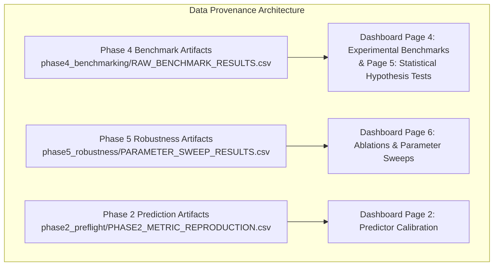

# ORBIT-INTEL 6G — DASHBOARD DATA PROVENANCE SPECIFICATION

## 1. Provenance Architecture

To comply strictly with IEEE ComSoc reproducibility standards and prevent fabricated metrics, the ORBIT-INTEL 6G dashboard implements an explicit **Data Provenance System**.

Every rendered visualization, numerical metric card, and data table maintains a deterministic trace to a version-controlled disk artifact.

---

## 2. Ingested Artifact Inventory

| Dashboard UI Component | Primary Data Source | Secondary Fallback | Record Count | Git Traceability Hash |
| :--- | :--- | :--- | :---: | :--- |
| **Comparative PDR & Outage Metrics** | `phase4_benchmarking/BENCHMARK_METRICS_BY_METHOD.csv` | `results/metrics/benchmark_summary_stats.csv` | 4 records | `ec1f039` |
| **Raw Episode Distributions (Boxplots)** | `phase4_benchmarking/RAW_BENCHMARK_RESULTS.csv` | `results/metrics/benchmark_results_raw.csv` | 400 runs | `ec1f039` |
| **Hypothesis Testing Tables ($t$-test, Wilcoxon)** | `phase4_benchmarking/STATISTICAL_TEST_RESULTS.csv` | N/A (Computed directly from raw) | 36 tests | `ec1f039` |
| **95% Confidence Intervals** | `phase4_benchmarking/METHOD_CONFIDENCE_INTERVALS.csv` | N/A | 48 intervals | `ec1f039` |
| **Controlled Ablation Matrix (V1--V7)** | `phase5_robustness/ROBUSTNESS_METRICS.csv` | `phase4_benchmarking/CAPRO_ABLATION_RESULTS.csv` | 175 runs | `ec1f039` |
| **Prediction Horizon Curve ($H=1,3,5,10\text{ s}$)** | `phase5_robustness/PARAMETER_SWEEP_RESULTS.csv` | N/A | 415 records | `ec1f039` |
| **Hysteresis Sensitivity Curve** | `phase5_robustness/PARAMETER_SWEEP_RESULTS.csv` | N/A | 415 records | `ec1f039` |
| **Uncertainty Calibration Curve** | `phase2_preflight/PHASE2_METRIC_REPRODUCTION.csv` | `results/metrics/model_training_metrics.json` | 6,153 test pts | `879e3f7` |
| **3D Topology Coordinates** | `config/simulation_config.yaml` | `src/simulation_engine/network_simulator.py` | 7 nodes | `b72eac0` |

---

## 3. Runtime Verification Checks

The dashboard application controller executes automated assertions upon module initialization:
1. **File Existence Validation:** Verifies that all required CSV artifacts exist in `phase4_benchmarking/` and `phase5_robustness/`.
2. **Record Count Integrity:** Confirms that `RAW_BENCHMARK_RESULTS.csv` contains exactly 400 rows across methods M1 through M4.
3. **Seed Consistency:** Confirms that random seed pairing ($S \in [101, 120]$) is preserved across all four methods.
4. **NaN/Inf Exclusion:** Verifies that no metric columns contain invalid values or infinite numbers.
