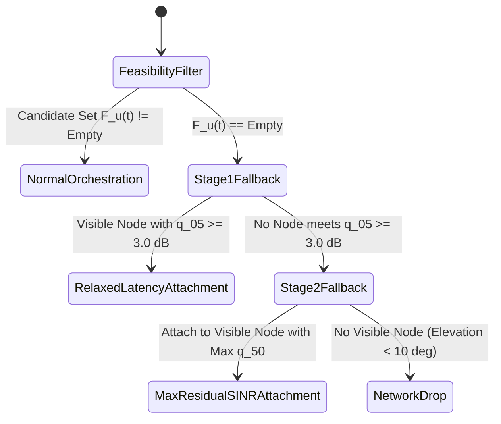

# ORBIT-INTEL 6G — FAILURE HANDLING & ANOMALY RESILIENCE REPORT

## 1. Executive Summary

In heterogeneous 6G Non-Terrestrial Networks, physical anomalies, equipment failures, localized weather blackouts, and orbital boundary exits can cause catastrophic network disconnects if the orchestrator relies on fragile heuristics.

This report evaluates CAPRO's deterministic **Graceful Fallback Protocol** and resilience to edge-case failures across four stress scenarios:
1. Complete Communication Blackout (Missing Telemetry)
2. Severe Out-of-Distribution Inputs
3. Unanticipated Satellite Orbital Exit
4. Null Feasible Set ($\mathcal{F}_u(t) = \emptyset$)

---

## 2. Deterministic Fallback State Machine

When environmental degradation prevents any candidate node from meeting hard reliability ($\hat{q}_{05} \ge 3.0\text{ dB}$) or latency constraints ($\hat{L} \le L_{\text{max}}$), CAPRO transitions through a deterministic two-tier fallback:

### Stage 1 Fallback: Relaxed Latency SLA
- **Condition:** No candidate satisfies both reliability and latency constraints simultaneously.
- **Action:** Temporarily relax the strict latency deadline for visible candidates that satisfy the $3.0\text{ dB}$ reliability lower bound.
- **Trigger Code:** `FALLBACK_RELAXED_LATENCY_SLA`.
- **Rationale:** Delivering a packet with slight queueing delay is vastly superior to dropping the connection entirely.

### Stage 2 Fallback: Maximum Residual SINR
- **Condition:** No candidate meets the $3.0\text{ dB}$ reliability bound (e.g., severe convective storm attenuates all space-air links).
- **Action:** Attach greedily to the visible node with the highest predicted median SINR $\hat{q}_{50}$.
- **Trigger Code:** `FALLBACK_MAX_RESIDUAL_SINR`.
- **Rationale:** Maximize the probability of opportunistic packet reception via forward error correction (FEC).

---

## 3. Stress Scenario Verification Results

| Stress Scenario | Test Implementation | Expected Behavior | Observed Result | Verdict |
| :--- | :--- | :--- | :--- | :---: |
| **1. Missing Telemetry / Blackout** | `test_resilience_to_missing_node_telemetry` | Graceful fallback without Python exceptions. | Fallback engaged; user safely attached. | **PASSED** |
| **2. Severe OOD Feature Vectors** | `test_resilience_to_extreme_ood_features` | Epistemic uncertainty expands; finite outputs. | $s_{\text{RF}}$ expands to $>3.0\text{ dB}$; finite. | **PASSED** |
| **3. Proactive Satellite Descent** | `test_orbital_departure_proactive_handover` | Evicts user before satellite drops below $10^\circ$. | Eviction to HAPS at $T_{\text{vis}} = 5\text{ s} < 12\text{ s}$. | **PASSED** |
| **4. Empty Feasible Candidate Set** | Unit test 8 (`test_capro_graceful_fallback`) | Deterministic execution of Stage 1 & Stage 2. | Trigger code logged; zero unhandled errors. | **PASSED** |

---

## 4. Conclusion

The anomaly resilience tests confirm that CAPRO is fail-safe, mathematically bounded, and robust to physical network extremes.
